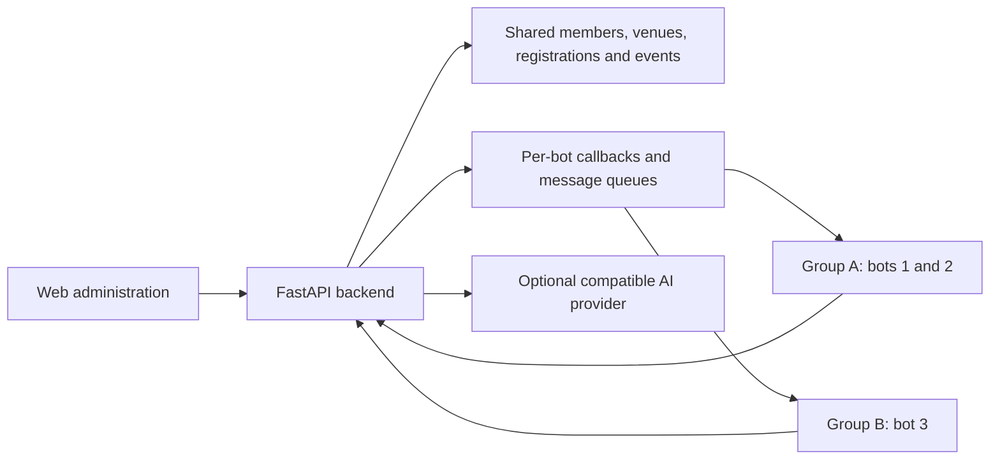

# Robort · Venue & Activity Management

English | [简体中文](README.zh-CN.md)

A self-hosted platform built with **FastAPI, SQLite and a responsive web interface**. Manage members, venue bookings, activities, permissions and messages in one backend, with multiple **Webhook-connected bots** as chat entry points.

**Currently used for badminton association management, and extensible to other venue reservation and activity organization scenarios.** Members, venues, schedules, registrations and notifications are general-purpose modules; badminton formats and scoring are provided as dedicated modules that can be adapted to other activities.

Current application version: **v1.0**. The interface and bot commands are currently in Chinese; the README, deployment guide and integration guide are available in both languages.

[Quick start](#quick-start) · [Bot integration](#connect-a-bot) · [Deployment](docs/DEPLOYMENT.md) · [Integration reference](docs/INTEGRATION.md) · [MIT license](LICENSE)

## Features

| Area | Capabilities |
| --- | --- |
| Members | Personal registration links, application review, Excel/CSV pre-registration with automatic column matching, groups, gender, approved levels **1–9**, management roles and membership renewal periods. |
| Profile changes | Request changes to name, gender, phone, level or groups through a bot or personal form; review in the admin page or chat, retain history and notify the member. |
| Registration | Book today's or future sessions; add named guests or `+N` guests; cancel yourself or selected guests; configure regular, substitute and waiting places. |
| Venues and schedules | Multiple venues, recurring rules, date-specific plans, individual holiday plans, event reservations and other occupancy. |
| Activity calendar | Registration counts, capacity bars, venues and sessions, with holiday, weekend, makeup workday, event and occupancy markers; drill down by day and session. |
| Daily competitions | Select an eligible format from session participants, generate draws, record scores and resume unfinished competitions. |
| Large events | Registration windows and keywords, staff, groups, draws, schedules, results, photo/file archives and notifications through selected bots. |
| Match history | Casual singles/doubles records, personal results, partner combinations and opponent statistics. |
| Bots and groups | Multiple bots in one group; **one current group per bot**. Configure capabilities, venues, sessions, member eligibility and per-feature availability windows; help adapts to each bot. |
| Messages | Compose, preview and send text, images and file links; schedule reminders by message type, bot, date, workday/weekend/holiday conditions and time. |
| Optional AI | Natural-language business requests, multi-step plans, numbered previews and simple `确认` confirmation before changes. |

Membership approval, club roles and event-specific staff roles are separate. Approved members share their identity across this backend's bots and venues. Expired membership prevents new registrations while preserving access to history.

New registration requires a **name and gender**; self-rating and phone are optional. Imports accept incomplete profiles with at least a name or phone; members complete missing information through a personal link for administrator review. Internal IDs are generated automatically. Account linking uses exact normalized phone matching, never name-only matching. This matches administrator-entered records; **SMS ownership verification is not implemented**.

See [member imports and time rules](docs/MEMBER_OPERATIONS.md) for setup and integration fields.

### Competition formats

| Format | Independent Python module | Entry requirement |
| --- | --- | --- |
| Round robin / 积分赛 | `round_robin.py` | At least 2 singles players or 4 fixed-doubles players |
| Five-player rotation / 五人转 | `five_rotation.py` | Exactly 5 players |
| Five-person team relay / 五羽伦比 | `five_team.py` | At least 10 players, in multiples of 5 |
| Single elimination / 单淘汰 | `single_elimination.py` | At least 2 singles players or 4 fixed-doubles players |
| Double elimination / 双败淘汰 | `double_elimination.py` | At least 2 singles players or 4 fixed-doubles players |
| Group stage + knockout / 分组淘汰 | `group_knockout.py` | At least 4 singles players or 8 fixed-doubles players |
| Doubles rotation / 双打轮转 | `doubles_rotation.py` | 4–40 players |

Disciplines include singles, open doubles, men's doubles, women's doubles and mixed doubles, subject to each format's rules. Fixed doubles requires even player counts; gender-specific events validate team composition. Draw options include random, seeded, balanced and stronger-with-weaker allocation. These are **club templates**, not federation-certified rules; see [format rules and limits](docs/formats.md).

### Schedules and holidays

Schedule precedence is **explicit date plan → enabled holiday plan → recurring rules**. Each recurring rule can skip statutory holidays. An enabled holiday plan with no sessions closes daily registration for that period.

Annual holiday data comes from [holiday-cn](https://github.com/NateScarlet/holiday-cn), with a bundled 2026 dataset and local caching. This is a community dataset based on government notices, not a government API. Ordinary registration queries do not make external holiday requests.

Event reservations and other configured occupancy block conflicting registrations. Future schedule edits synchronize applicable sessions; historical and already-started sessions keep their original times and registration snapshots. Conflicting changes affecting existing bookings are rejected.

## Architecture



The backend owns business data. Bots expose selected services and route messages; they do not create separate member databases. Management actions also require the sender's role. Event staff permissions apply only to their event.

Run **one Uvicorn worker**, including the scheduler and durable outbox. SQLite is the current storage backend; horizontal scaling and distributed scheduling are not supported.

## Quick start

Requirements: Python **3.10**, `pip` and Git. The bundled HTML/CSS/JavaScript frontend needs no Node.js build. Node.js is used for frontend tests; browser tests additionally require Playwright and a browser.

Clone [li-bruce/RobotReport](https://github.com/li-bruce/RobotReport) or unpack its source, then open a terminal in the project directory. The repository name is RobotReport; the application package remains Robort.

### Linux / macOS

```bash
python3.10 -m venv .venv
. .venv/bin/activate
python -m pip install -r requirements.lock
python -m scripts.bootstrap --state state/demo --demo
python -m scripts.set_admin_password --state state/demo
python -m scripts.export_env --state state/demo --output .env.local
python -m uvicorn app.main:app --host 127.0.0.1 --port 9874 --workers 1 --no-access-log
```

### Windows PowerShell

```powershell
py -3.10 -m venv .venv
$RobortPython = Join-Path (Get-Location) '.venv\Scripts\python.exe'
& $RobortPython -m pip install -r requirements.lock
& $RobortPython -m scripts.bootstrap --state state/demo --demo
& $RobortPython -m scripts.set_admin_password --state state/demo
& $RobortPython -m scripts.export_env --state state/demo --output .env.local
& $RobortPython -m uvicorn app.main:app --host 127.0.0.1 --port 9874 --workers 1 --no-access-log
```

The export creates a private `.env.local` that is loaded automatically. The public [`.env.example`](.env.example) contains empty values only; see [local configuration](docs/ENVIRONMENT.md) for manual setup and existing installations.

Set your own password at the hidden prompt; there is **no published default administrator password**. You can change it later in system settings.

| Page | Local address |
| --- | --- |
| Administration | <http://127.0.0.1:9874/admin> |
| Member guide | <http://127.0.0.1:9874/guide/member> |
| Administrator guide | <http://127.0.0.1:9874/guide/admin> |
| Health/version | <http://127.0.0.1:9874/healthz> |

`--demo` creates two synthetic bots and two approved sample users, with no real outgoing webhook. For a new production installation, use a separate state directory and omit `--demo`.

`ROBORT_LIVE_SEND=0` disables real bot messages. **It is not read-only mode**: the simulator still changes its state directory, and enabled AI can still call its provider. Use isolated state and disable AI for experiments.

## Connect a bot

1. Prepare a Webhook integration: a platform or adapter sends trusted user/group events and accepts outgoing messages.
2. Add its exact HTTPS sending endpoint to `ROBORT_WEBHOOK_JSON_ENDPOINTS` in the local env file and restart.
3. In **机器人与群**, create/select a group, add a bot, paste its sending URL and select businesses, venues and sessions.
4. Copy the generated callback URL into the platform or adapter. Configure a public HTTPS origin and enable delivery with `ROBORT_LIVE_SEND=1`.
5. Mention the bot and send `连接` or `帮助`. An authenticated event identifies the group and a successful reply verifies the connection. The connection editor also offers a sending test.

Webhook platforms differ in payloads, signatures, mentions and attachment APIs. Platforms matching the generic JSON contract can connect directly; others need an adapter. See the [message contract](docs/INTEGRATION.md). Existing compatible integrations remain available.

## Chat examples

Mention the intended bot, then send one of these Chinese commands. `帮助` shows available functions for that bot and member.

| Task | Message |
| --- | --- |
| Register / check application | `注册` / `注册资料` |
| Request profile changes | `修改资料` / `申请分组 提高组` / `申请等级 5级` |
| Track / withdraw profile requests | `我的资料申请` / `取消资料申请` |
| Member-manager profile review | `资料待审核` → `资料查看 申请12` → `资料通过 申请12` |
| Join / view registrations | `报名` / `名单` |
| Add guests | `报名，张三，李四` or `报名+2` |
| Cancel yourself / your guests | `取消报名` / `取消张三，李四` |
| Reserve a session | `明天第二场报名` or `2026-10-18 18:00 报名` |
| Choose a venue | `场地2 报名` |
| Start daily planning | `组织比赛` or `组织比赛 混双`, then choose a listed format |
| Record a score | `周二双打，第十二场21：19` |
| Draw / personal schedule | `周二双打，对战表` / `周二双打，我的赛程` |
| Resume an event | `继续比赛` |
| Casual match | `记录 双打 我、张三 VS 李四、王五 21-19` |
| Personal queries | `我的统计` / `我的会籍` / `我的对战历史` / `我的对战统计` |
| Member-manager review | `待审核`, then `审核通过 申请12` |
| AI request | `AI 明天第一场帮我报名，再看名单` → review → `确认` |

Each `报名+N` adds **N more guests**, preserving earlier guests. Cancelling yourself leaves guests registered. Only the member who added a guest may cancel that guest through chat. Regular/substitute labels describe activity places, not membership approval.

## Optional AI

Use an **OpenAI-compatible Chat Completions endpoint with tool calling**. Add the base URL to local `ROBORT_AI_ENDPOINTS`, then configure the URL, model, API key, enable switch and confirmation expiry under **系统设置 → AI**. Enable AI for the intended bots. Providers and models are configurable; non-standard extensions may require an adapter.

Ordinary commands run directly. Requests starting with `AI`, `AI:`, `AI：` or `/ai` use the AI workflow. Queries may return immediately; changes produce numbered steps. The same user replies **`确认` in the original bot/group**. `AI + changes` replaces the pending plan; `AI进度` checks progress; `取消计划` discards it.

Each user has one current plan, with at most eight steps. Execution rechecks membership, roles, bot capabilities and activity scope. A failed step stops later steps; completed results are retained. Forms and uploads return the appropriate page; missing or unsupported requests prompt clarification. AI is optional and disabled by default.

## Development and operations

```bash
python -m pytest -q
# Frontend checks in Bash:
for file in tests/*.cjs tests/*.js; do node "$file" || exit 1; done
```


```text
app/                 FastAPI, domain services, bot transport and AI workflows
app/formats/         Independent competition generators
app/static/          Administration, registration and member/admin guides
app/data/holidays/   Bundled holiday data
scripts/             Bootstrap, password setup, migration and browser tools
tests/               Business, authorization, API and frontend checks
docs/                Deployment, integration and competition rules
state/               Private runtime data; ignored by Git
```

See [Deployment](docs/DEPLOYMENT.md) for service installation, upgrades and data migration, and [Integration](docs/INTEGRATION.md) for callback payloads, authentication and API examples. Keep databases, credentials, uploads and backups out of Git.

Maintainers can find the shared inbound contract in [Message parsing](docs/MESSAGE_PARSING.md) and updates in the [Changelog](docs/CHANGELOG.md).

## License

Project code and documentation use the [MIT License](LICENSE). Bundled fonts and holiday data retain their own notices; see [Third-party notices](THIRD_PARTY_NOTICES.md).
