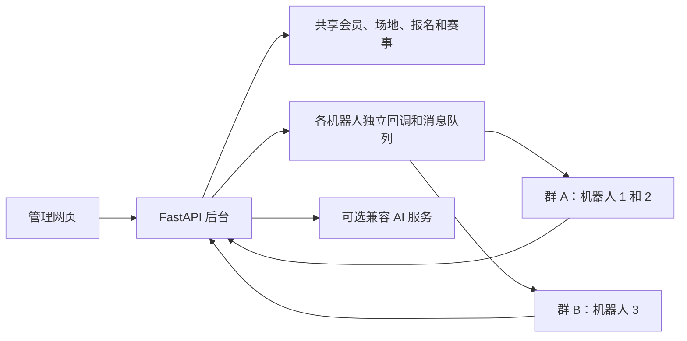

# Robort · 场地预约与活动管理

[English](README.md) | 简体中文

基于 **FastAPI、SQLite 和响应式网页**的会员、场地预约与活动组织平台。一个后台统一管理会员、场地、报名、赛事、权限和消息，通过多个 **Webhook 机器人**提供群内服务。

**当前用于羽毛球协会管理，也可扩展到其他场地预定和活动组织场景。** 会员、场地、时段、报名与通知是通用业务；羽毛球赛制和计分作为独立模块提供，可按其他活动规则扩展。

当前应用版本：**v1.0**。管理页面和机器人指令目前使用中文；README、部署说明和对接说明提供中英双语。

[快速启动](#快速启动) · [机器人接入](#机器人接入) · [部署与迁移](docs/DEPLOYMENT.zh-CN.md) · [接口对接](docs/INTEGRATION.zh-CN.md) · [MIT 许可证](LICENSE)

## 主要特性

| 模块 | 能力 |
| --- | --- |
| 会员管理 | 本人链接注册、申请审核、Excel/CSV 自动识别列名、逐条或批量确认重复人员、批量预登记与本人确认、组别、性别、1–9 级审核、独立管理角色、多段会籍与续费记录。 |
| 资料调整 | 通过机器人或本人表单申请修改姓名、性别、手机号、等级和分组；后台或群内审核，保留历史并通知本人。 |
| 活动报名 | 当日报名与预约、具名代报名及 `+N` 追加同行、按人取消、正式/替补/候补名额、等级和组别限制。 |
| 场地与时段 | 多场地、周期时段、指定日期安排、独立节假日安排、大型赛事和其他活动占用。 |
| 可视化日历 | 人数、容量进度、场地和场次，节假日、周末、调休上班日、比赛日及占用标记；按日期展开各场地场次。 |
| 每日趣味赛 | 根据报名人员选择适用赛制、生成对战表、记分排名、暂停及继续未完成赛事。 |
| 大型赛事 | 报名时间和关键词、负责人及临时职务、分组抽签、赛程安排、跨群通知、成绩和照片/附件归档。 |
| 零散对局 | 登记单打与双打对局，查询个人对战历史、搭档组合和对手胜率。 |
| 机器人与群 | 一个群多个机器人、一个机器人一个当前群；机器人管理与群关联图分开，连线配置收发地址；配置业务组合、场地、场次和用户属性限制，动态生成帮助。 |
| 消息运营 | 文本、图片、文件链接公告的编辑、预览、定向发送，按内容、机器人、日期、工作日/周末/节假日和时间配置定时播报。 |
| 可选 AI | 自然语言理解、跨模块多步骤操作、编号预览、直接回复“确认”、修改或取消待执行方案。 |

会员审批、后台角色和赛事临时职务相互独立。会员资格在同一后台的机器人和场地间通用；会籍到期或处于续费间隔时不能新增报名，仍可查历史。

新用户注册时**姓名和性别必填，自评级别与手机号选填**。导入名册即由管理员确认会员资格；本人发送“注册确认”，通过个人链接核对资料，唯一姓名匹配后直接关联。重名用手机号区分，已绑定账号不自动换绑；未匹配人员进入注册审核。等级、组别留空不影响注册。会员档案的“申请待审”统一处理注册、等级与资料调整，保留审核历史。

### 七种独立赛制

| 赛制 | 独立模块 | 主要人数要求 |
| --- | --- | --- |
| 积分赛 | `round_robin.py` | 单打至少 2 人；固定双打至少 4 人 |
| 五人转 | `five_rotation.py` | 恰好 5 人 |
| 五羽伦比 | `five_team.py` | 至少 10 人，人数为 5 的倍数 |
| 单淘汰 | `single_elimination.py` | 单打至少 2 人；固定双打至少 4 人 |
| 双败淘汰 | `double_elimination.py` | 单打至少 2 人；固定双打至少 4 人 |
| 分组淘汰 | `group_knockout.py` | 单打至少 4 人；固定双打至少 8 人 |
| 双打轮转 | `doubles_rotation.py` | 4–40 人 |

支持单打、普通双打、男双、女双和混双，以对应赛制的校验规则为准。固定双打要求偶数人数，男双/女双/混双同时校验性别组合。可使用随机、种子分布、平均分布、高带低等编排方式。这些是可配置的**俱乐部赛事模板**；完整人数上限、计分和晋级规则见[赛制说明](docs/formats.md)。

### 时段与节假日

安排优先级为：**指定日期非周期安排 → 已启用节假日安排 → 周期规则**。每条周期规则可分别设置是否跳过法定节假日。节假日安排启用但无场次时，该时段不开放日常报名。

年度节假日数据来自 [holiday-cn](https://github.com/NateScarlet/holiday-cn)，内置 2026 年数据并保留本地缓存。这是整理政府公告的社区数据源，并非政府接口；日常报名查询不依赖外部节假日请求。

大型赛事和其他活动占用会阻止冲突时段的新报名。修改未来时段后相应场次同步更新；历史和已开始场次保留原时间及报名快照。涉及已有报名或赛事占用的冲突修改会被拒绝。

## 图文操作说明

- [普通用户版](docs/MEMBER_GUIDE.zh-CN.md)：注册与本人确认、资料补全、报名代报、每日赛事、对局和查询。
- [管理员版](docs/ADMIN_GUIDE.zh-CN.md)：导入与重复人员核对、通知本人、审核续费、权限配置、机器人接入及大型赛事。

两版说明按实际页面编写，配有可查看大图的操作截图；截图使用虚构数据。服务内也可打开 `/guide/member`、`/guide/admin`。


## 系统架构



后台保存统一业务数据，机器人提供选定业务并收发消息。机器人开启管理功能，不代表所有群成员获得该项权限；后台按实际用户角色核验。赛事职务只作用于相应赛事。

当前采用 SQLite，由**一个 Uvicorn worker**运行服务、调度器和持久化消息队列；暂不支持多实例水平扩展或分布式调度。

## 快速启动

需要 Python **3.10**、`pip` 和 Git。前端为随服务发布的 HTML/CSS/JavaScript，运行时无需 Node.js 构建。

克隆本仓库或下载源码，进入项目目录后执行。

### Linux / macOS

```bash
python3.10 -m venv .venv
. .venv/bin/activate
python -m pip install -r requirements.lock
python -m scripts.bootstrap --state state/demo --demo
python -m scripts.set_admin_password --state state/demo
python -m scripts.export_env --state state/demo --output .env.local
python -m uvicorn app.main:app --host 127.0.0.1 --port 9874 --workers 1 --no-access-log
```

### Windows PowerShell

```powershell
py -3.10 -m venv .venv
$RobortPython = Join-Path (Get-Location) '.venv\Scripts\python.exe'
& $RobortPython -m pip install -r requirements.lock
& $RobortPython -m scripts.bootstrap --state state/demo --demo
& $RobortPython -m scripts.set_admin_password --state state/demo
& $RobortPython -m scripts.export_env --state state/demo --output .env.local
& $RobortPython -m uvicorn app.main:app --host 127.0.0.1 --port 9874 --workers 1 --no-access-log
```

导出命令创建自动加载的私有 `.env.local`。公开的 [`.env.example`](.env.example) 各项均为空，手动填写和已有环境导出见[本地配置说明](docs/ENVIRONMENT.zh-CN.md)。

密码脚本使用隐藏输入；项目**不提供公开默认管理员密码**。登录后可在系统设置修改。

| 页面 | 本地地址 |
| --- | --- |
| 管理后台 | <http://127.0.0.1:9874/admin> |
| 普通用户说明 | <http://127.0.0.1:9874/guide/member> |
| 管理员说明 | <http://127.0.0.1:9874/guide/admin> |
| 健康状态与版本 | <http://127.0.0.1:9874/healthz> |

`--demo` 创建两个模拟机器人和两名已审核演示用户，不配置真实发送地址。新建生产环境时使用独立状态目录，并去掉 `--demo`。

`ROBORT_LIVE_SEND=0` 关闭真实群消息，但**不是只读模式**：对话演练仍会修改其状态目录，开启 AI 后仍可能调用模型。实验请使用独立状态目录，并关闭 AI。

## 机器人接入

1. 准备 Webhook 接入端：平台或适配器提供可信的用户、群和消息事件，并接收后台发送的消息。
2. 在本地环境文件 `ROBORT_WEBHOOK_JSON_ENDPOINTS` 中填写适配器的完整 HTTPS 发送端点，重启服务。
3. 在“机器人与群”新建或选择群、添加机器人、填写发送地址，并选择业务、场地和场次。
4. 将后台生成的回调地址填入平台或适配器；设置公网 HTTPS 地址，并用 `ROBORT_LIVE_SEND=1` 开启真实发送。
5. 在群里 @机器人发送“连接”或“帮助”。有效回调识别群，成功回复完成连接验证；连接编辑页也支持发送测试消息。

不同平台的消息体、签名、@语法和附件接口存在差异。符合通用 JSON 契约的平台可以直接接入，其他平台通过适配器转换。详见[消息格式与对接说明](docs/INTEGRATION.zh-CN.md)。已有兼容接入方式继续可用。

## 常用对话

在群内 @目标机器人后发送；`帮助` 按机器人业务组合及当前身份显示适用指令。

| 操作 | 发送示例 |
| --- | --- |
| 注册 / 查询申请 | `注册` / `注册资料` |
| 申请调整资料 | `修改资料` / `申请分组 提高组` / `申请等级 5级` |
| 查询或撤回资料申请 | `我的资料申请` / `取消资料申请` |
| 会员管理员审核资料 | `资料待审核` → `资料查看 申请12` → `资料通过 申请12` |
| 报名 / 查名单 | `报名` / `名单` |
| 追加同行 | `报名，张三，李四` 或 `报名+2` |
| 取消本人 / 指定同行 | `取消报名` / `取消张三，李四` |
| 预约场次 | `明天第二场报名` 或 `2026-10-18 18:00 报名` |
| 指定场地 | `场地2 报名` |
| 发起每日赛事 | `组织比赛` 或 `组织比赛 混双`，再选择回复中的赛制 |
| 记比赛比分 | `周二双打，第十二场21：19` |
| 查对战表 / 本人赛程 | `周二双打，对战表` / `周二双打，我的赛程` |
| 恢复未完成赛事 | `继续比赛` |
| 零散对局 | `记录 双打 我、张三 VS 李四、王五 21-19` |
| 个人查询 | `我的统计` / `我的会籍` / `我的对战历史` / `我的对战统计` |
| 会员管理员审核 | `待审核`，然后 `审核通过 申请12` |
| AI 办理 | `AI 明天第一场帮我报名，再看名单` → 核对步骤 → `确认` |

每次 `报名+N` 都会**新增 N 名同行**，保留原同行；取消本人不取消同行，群内只能取消本人代报的人员。正式/替补是活动名额，与会员是否注册、审核是两回事。

## AI 配置

使用支持 **OpenAI 兼容 Chat Completions 和工具调用**的模型服务。在本地 `ROBORT_AI_ENDPOINTS` 添加接口基础地址，再到“系统设置 → AI”配置地址、模型名称、API Key、开关和确认有效期，并为目标机器人开启“AI”业务。平台与模型可替换；非标准扩展需要相应适配。

普通指令直接办理；以 `AI`、`AI:`、`AI：` 或 `/ai` 开头进入 AI 流程。查询可直接返回，包含变更时先给出编号步骤；本人在**原机器人、原群**回复 `确认` 执行。发送 `AI + 修改意见` 覆盖待确认方案，`AI进度` 查看执行情况，`取消计划` 放弃。

每人只保留一份当前方案，每次最多八步。执行时重新核验会员资格、管理角色、机器人业务和场地范围；某步失败停止后续步骤，已完成结果保留。表单、上传类业务给出页面入口；信息不足或无法办理时提示补充。AI 默认关闭，不影响固定指令和管理页面。

## 开发与维护

```bash
python -m pytest -q
# Bash 中运行前端检查：
for file in tests/*.cjs tests/*.js; do node "$file" || exit 1; done
```


```text
app/                 接口、业务模块、机器人传输、AI 流程
app/formats/         独立赛制脚本
app/static/          管理后台、注册页、普通用户/管理员说明
app/data/holidays/   内置节假日数据
scripts/             初始化、密码设置、迁移及浏览器测试
tests/               业务、权限、接口和前端检查
docs/                部署、对接和比赛规则
state/               私有运行数据，不进入 Git
```

服务安装、升级、备份恢复和迁移见[部署说明](docs/DEPLOYMENT.zh-CN.md)。回调报文、认证及 API 示例见[对接说明](docs/INTEGRATION.zh-CN.md)。数据库、凭据、上传文件和备份均不应提交到仓库。

统一输入契约见[消息解析方案](docs/MESSAGE_PARSING.zh-CN.md)，版本改动见[变更记录](docs/CHANGELOG.md)。

## 许可证

项目代码和文档采用 [MIT 许可证](LICENSE)。内置字体和节假日数据保留各自许可与署名，见[第三方组件说明](THIRD_PARTY_NOTICES.md)。

名册导入、资料补全、定时播报与机器人功能开放时间：[配置及对接说明](docs/MEMBER_OPERATIONS.zh-CN.md)。
