# 聚场 · 管理员操作说明

v1.0 · 2026-10-22。服务中的网页版：`/guide/admin`。

按当前页面编写；截图均为隔离环境中的虚构数据。图片可点开查看原尺寸。示例姓名、日期、场次请按实际替换。

## 管理工作入口

### 登录后，从要办的事开始

打开管理工作台，使用**管理员密码**登录。密码可在“系统设置”修改。

**让一个群开始使用**：先配置场地和时段，再接入机器人、勾选业务、连接群。

**处理新会员**：审核申请，按需核准等级、设置组别、登记会籍。

**举办公开赛或联赛**：先创建草稿与安排人员，再开放报名、抽签和排赛。

群内管理员及子权限在“人员中心 → 角色与权限”分配，不是各自的网页登录账号。注册、报名和普通参赛用法见普通用户版。

列表左侧的“序号”按当前显示顺序从 1 编排，筛选后重新编号。

进入管理工作台 →（后台 `/admin#dashboard`）

## 机器人接入与分工

### 1. 机器人管理：名称与分工

1. 进入**机器人与群 → 机器人管理**，点击**新建机器人**。
2. 填写名称，勾选业务。注册、报名、每日赛事、零散对局、统计和消息默认开启；AI、大型赛事、群内管理默认关闭。
3. 按需设置场地、场次、用户条件及功能开放时间，保存。
4. 点击机器人行展开，直接编辑**名称与功能、服务范围、用户条件、功能开放时间**，点击**保存机器人设置**。下方**定时播报**单独保存。

收起时显示关联群、场地、业务、服务场次与播报时间。展开后的设置都属于当前机器人；收起再展开会保留未保存的输入。连接地址仍在“群关联”分页配置。

打开机器人管理 →（后台 `/admin#bots`）

看图操作：机器人管理

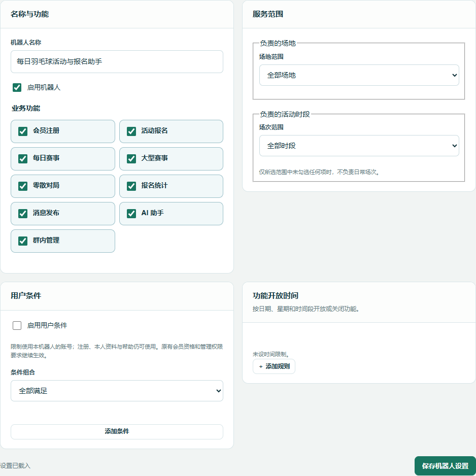

图 7 · 展开机器人即可编辑各项设置；群连接仍在“群关联”。 [查看大图 ↗](../app/static/guide-images/admin-bots.png)

### 2. 群关联：点击连线配置

1. 切到**群关联**，新建群只填名称。
2. 点击图中的机器人或连线，选择群，粘贴群里提供的**发送 Webhook**。
3. 复制**机器人回调地址**，填到平台上同一个机器人的消息接收设置。两个地址可一起配置。
4. 点击**保存并测试发送**，然后在群里 @对应机器人发送`连接`；后台显示“已连接”。

一个群可连多个机器人，一个机器人只连一个群。群 ID 自动识别，无需输入。左侧可改名、删除群；连接弹窗可暂停或解除。

仅接收时可留空发送地址；仅发送时关闭“接收群指令”，并选择已识别的群。接收结果能否直接显示在群里，取决于平台是否支持回调响应。

打开群关联 →（后台 `/admin#bot-links`）

看图操作：机器人与群的关系

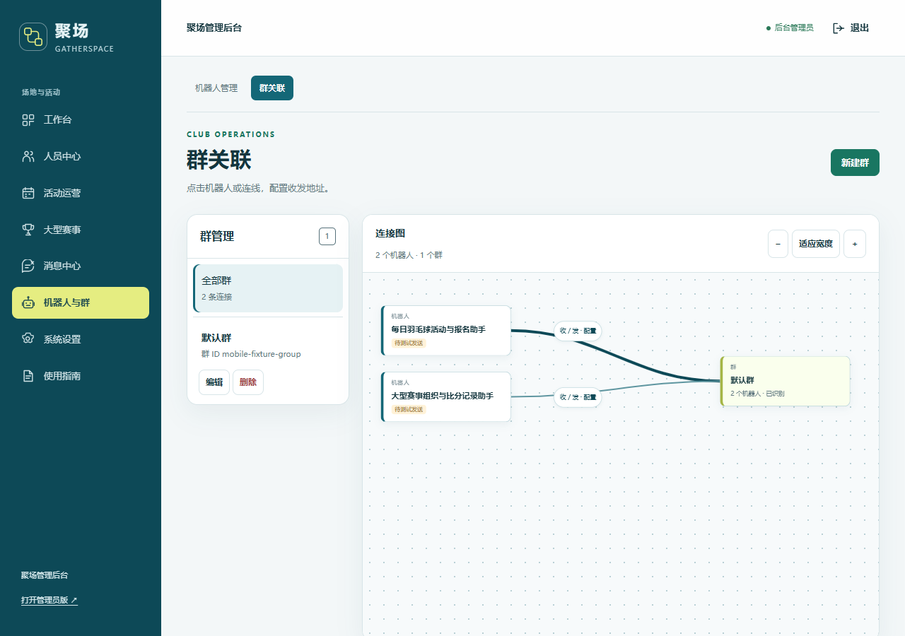

图 8 · 左侧管理群，点击机器人节点或连线编辑连接。 [查看大图 ↗](../app/static/guide-images/admin-bot-links.png)

### 3. 修改分工、换群或暂停

1. 展开机器人，点击**编辑名称与功能**修改名称、业务、场地和场次；用**帮助预览**检查群成员看到的指令。帮助会随业务开关、负责场地与场次即时变化，每项列出字段和可发送的示例；可切换会员、未注册用户和管理员预览。
2. 切到**群关联**，点击连线修改发送地址。换群时选择已有群，重新粘贴目标机器人的发送 Webhook，再去目标群 @它发送“帮助”。
3. 直接点击**接收指令**或**活动提醒**开关调整接收与提醒。
4. **暂停连接**可临时停止使用；**解除连接**后可重新选群连接。历史记录保留。

在群关联页新建群；群列表中的“编辑”可修改名称。场地和时段只需在机器人设置中配置。

#### 限制功能开放时间

编辑名称与功能 → 功能开放时间，选择本机器人已开启的功能，添加“仅这些时段开放”或“这些时段关闭”。可设置日期、星期、节假日和时段；关闭优先。时间留空为全天，22:00–02:00表示跨夜，按开始日判断星期。保存后帮助、指令、AI确认、个人表单和发送都按当前时间执行。

### 按用户属性限制使用

1. 展开机器人 → **编辑名称与功能 → 用户使用条件**，勾选启用。
2. 点击**添加条件**，选择属性、匹配方式和取值。可配置组别、已审核等级、性别、注册状态、角色、权限、姓名、账号、手机号、自评和审核信息、会籍状态及日期等。
3. 选择**全部满足**或**任一满足**，保存设置。

**例如学生女双：**组别包含“学生”、性别属于“女”、已审核等级不低于3，选择“全部满足”。范围3–6级，再加一条等级不高于6。

条件限制发指令的账号，也适用于群内管理员。注册、本人资料、补充性别、自评和帮助保留入口；业务仍需原有会员资格和管理权限。群里仅提示未满足的属性，不展示手机号或审核备注。新报名仍受会籍和活动要求限制；会籍到期查看历史的原有规则不变，除非另外启用本机器人的会籍条件。

### 删除不再使用的机器人

展开机器人，点击**删除机器人**并确认名称。它会停止收发、解除连接，从当前机器人列表移除。会员、报名、赛事、历史消息和同群其他机器人保留；已发出的消息不会撤回。

后台删除不会移除机器人平台群中的机器人；需要时在机器人平台中移除。只想暂时停用，可关闭“启用机器人”；只换群，到“群关联”点击当前连线。

### 4. 给机器人安排工作

| 机器人 | 勾选业务 | 负责场次 |
| --- | --- | --- |
| 会员服务 | 会员注册、报名统计 | 全部 |
| 晚场报名 | 活动报名、每日赛事 | 一号馆第一场 |
| 学生场 | 活动报名、每日赛事 | 一号馆第二场 |
| 赛事助手 | 大型赛事、消息发布 | 赛事所在场地 |

只保留所需业务。个人申请结果沿用接收申请的注册机器人，原机器人暂时不可用时保持待发；管理角色变更由“群内管理”机器人通知；普通通知按业务范围共享，同群不重复发送。AI需要同时开启全后台服务和本机器人的“AI助手”。

## 会员、审核与角色

### 先选注册方式，再处理申请

**管理员已有名单：**批量登记 → 核对重复人员 → 完成核对 → 通知本人确认 → 本人姓名匹配并提交 → 直接成为会员。

**没有预登记名单：**本人 @机器人“注册” → 填表提交 → 会员档案“申请待审” → 审核通过或退回 → 原注册机器人通知本人。

导入即核准会员资格，但不会凭姓名生成群账号。只有本人触发机器人，或与已有会员匹配关联后，档案才显示“已关联”。等级审核、会籍续费、管理角色是后续独立操作。

- [① 导入与核对](#roster-import)
- [② 关联与通知](#account-link)
- [③ 审核申请](#member-review)
- [④ 续费记录](#membership-renewal)

### 1. 导入名册，先核对人员

人员中心 → 批量登记

1. 选择 Excel（.xlsx / .xls）或 CSV，点击**上传并预览**。可用原有表格，不必先改成模板。
2. 展开**已识别的列**，核对姓名、手机号、性别、等级和组别是否对应正确。未知列会忽略；姓名与手机号至少填一项。
3. 处理**待确认**行：选择确为同一人的档案，点击**确认匹配**；不同人点击**不匹配，新增**。**批量确认匹配**只处理单一候选，重名多候选逐条选择。
4. 有错误先修改文件重新上传；全部核对后点击**完成核对 · 新增 N 人**。预览阶段尚未导入。
5. 在**预登记档案**查看结果。缺失资料可点**补全资料**；姓名、手机号都匹配已有会员时会关联，冲突时先核对档案。

无手机号时，可按姓名、昵称、邮箱、学号、工号、会员号等身份列查找候选；性别、等级和组别不单独判定为同一人。确认重复人员保留原档案，不用导入覆盖原会员。

每次最多 1000 人、2 MiB。手机号、等级、组别可留空；多个组别在文件中用分号分隔。点击“下载 CSV 模板”可查看标准列名。

看图操作：上传入口与重复人员核对

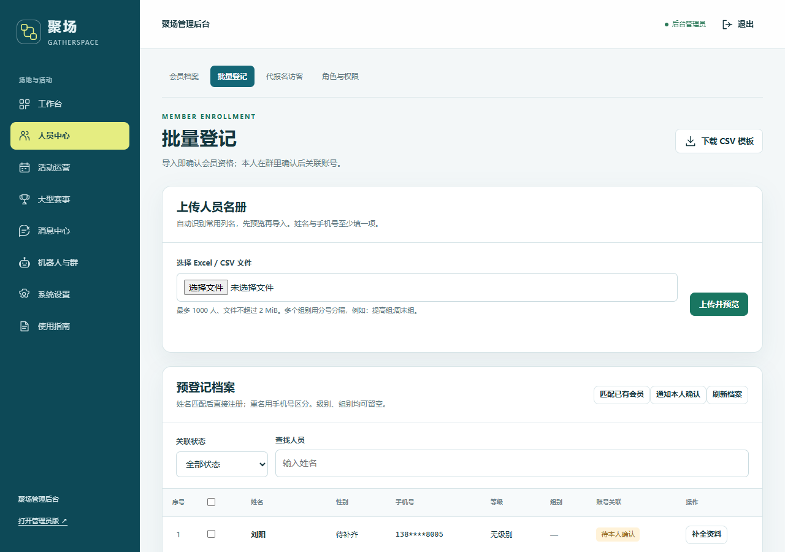

图 1 · 选择文件并“上传并预览”；下方管理预登记档案。 [查看大图 ↗](../app/static/guide-images/admin-imports.png)

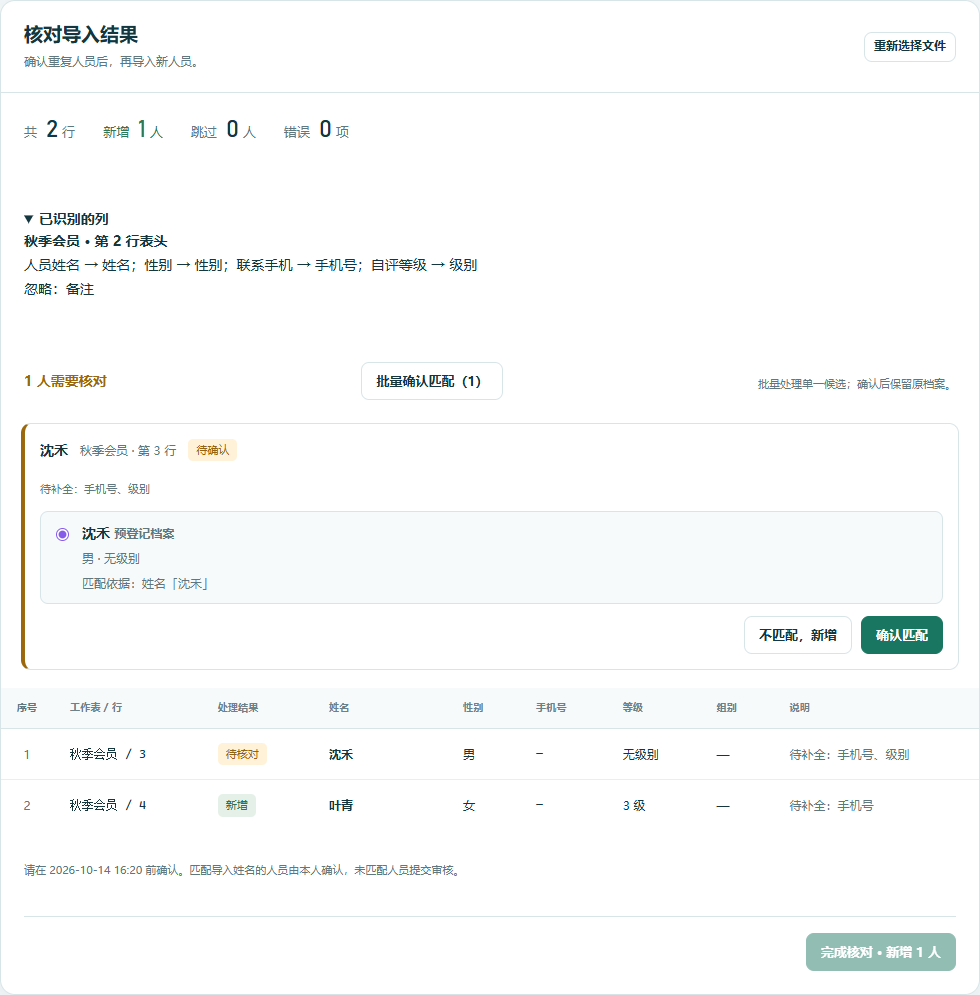

图 2 · 先看已识别的列，再确认同一人或作为新人员导入。 [查看大图 ↗](../app/static/guide-images/admin-import-preview.png)

### 2. 关联群账号，通知本人确认

人员中心 → 批量登记 → 预登记档案

1. **已有注册账号：**点击“匹配已有会员”，先看匹配原因，再点击“关联匹配的 N 人”。唯一姓名匹配且已有手机号不冲突时可关联；有冲突的先核对。
2. **还没有群账号：**勾选待关联人员，点击“通知本人确认”，选择负责注册的机器人 / 群。
3. 点击**预览通知**，核对姓名和发送群，再点**发送确认通知**。进入发送记录查看结果。
4. 成员收到通知后 @该机器人发送**注册确认**，打开本人链接核对姓名和性别。唯一姓名匹配即完成；重名时补登记手机号。
5. 点击**刷新档案**，或将“关联状态”切换为“已关联”核对。

姓名、手机齐全不等于已关联账号；级别、组别为空也不影响注册。只有姓名时通知会列出姓名，不会凭名字自动生成有效 @；有可用邮箱时可按邮箱 @。

通知只发到预览选中的机器人 / 群，不会随导入自动群发。可选机器人需开启“会员注册”、接收群指令，并配置发送地址。

看图操作：通知本人确认

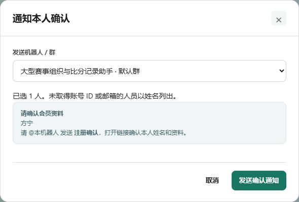

图 3 · 核对机器人 / 群和通知内容后，点击“发送确认通知”。 [查看大图 ↗](../app/static/guide-images/admin-invite.png)

### 3. 审核注册、等级和资料申请

人员中心 → 会员档案 → 申请待审

1. 点击**申请待审**，找到需要处理的会员。
2. 注册申请点**审核申请**，核对真实姓名、性别等资料，将**会员状态**设为“正式会员”或“申请未通过”，填写备注并**保存会员资料**。
3. 等级申请点**审核等级**单独处理；资料调整点**审核资料**，比较原资料与新内容，选择通过或退回并保存。
4. 回到档案检查结果；点击**通知记录**核对是否已发送。本人档案保留申请与审核记录。

办理审核需要会员管理权限。导入名册匹配完成的会员**不再审批注册**；若只剩等级或资料申请，只处理对应申请。

看图操作：筛选待审 → 审核申请

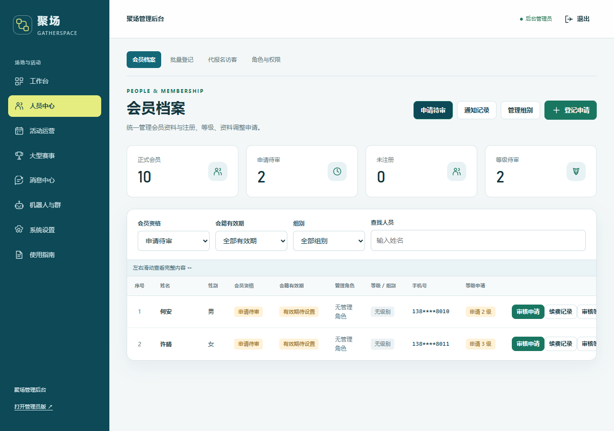

图 4 · “申请待审”汇总注册、等级和资料申请，按行选择操作。 [查看大图 ↗](../app/static/guide-images/admin-pending.png)

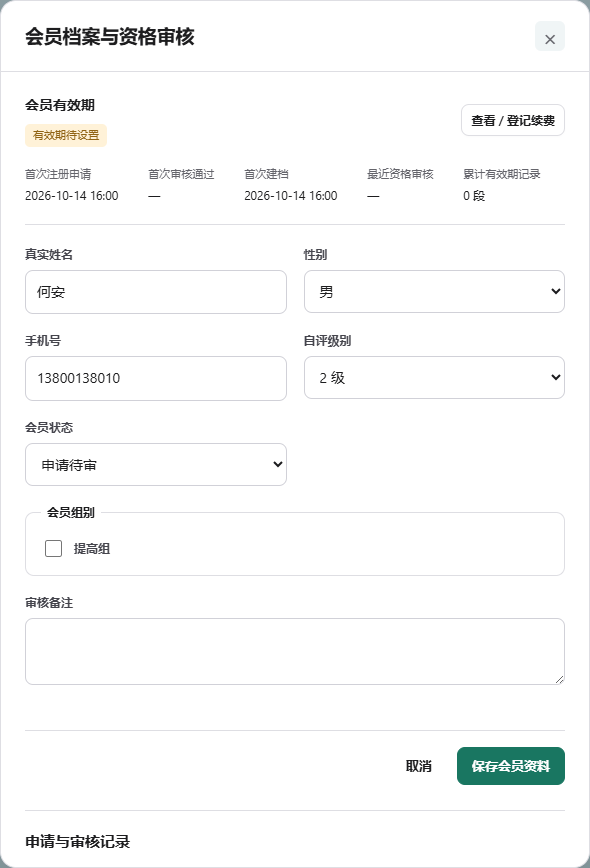

图 5 · 核对资料后修改“会员状态”，点击“保存会员资料”。 [查看大图 ↗](../app/static/guide-images/admin-review.png)

在群里审核：指令与结果

机器人需开启“群内管理”，操作人具备会员管理权限。

- `待审核`
- `审核通过 申请12`
- `审核拒绝 申请12`

唯一姓名可用 `审核通过 张三`；重名时按待审核名单中的申请编号办理。

资料调整用 `资料待审核`、`资料查看 申请12`、`资料通过 申请12` 或 `资料拒绝 申请12`。资料审核不能由申请人本人处理。

**你发送**：`审核通过 申请12`

**机器人反馈 · 节选**：审核通过申请12 · 张三；结果通知将投递。

**下一步**：会员收到原注册机器人的 @通知；暂未收到时先查会员状态和通知记录。

### 4. 维护资料、等级和组别

人员中心 → 会员档案

用**管理组别**维护可用组别；打开本人档案可编辑姓名、性别、手机号和组别。等级支持 1–9 级，自评申请通过后才显示已核准等级。不要用重复导入修改已关联会员。

会员也可发送“修改资料”“申请分组 提高组”“申请等级 5级”。这些申请统一进入**申请待审**，审核前原资料生效。分组申请提交的是完整组别列表。

注册、个人资料、等级与组别通知由“会员注册”机器人发布；本人申请优先沿用发起申请的机器人。它暂时不可用时保留待发，不换成同群的另一个机器人。管理角色变更由“群内管理”机器人通知。

### 5. 登记会籍与每次续费

人员中心 → 会员档案 → 本人行“续费记录”

1. 先确认会员资格已通过，再打开**续费记录**。
2. 展开**登记一段有效期**，填写开始日期、结束日期；可点击**按开始日填写一年**，金额和备注选填。
3. 点击**保存有效期**。下一次续费新增一段，不覆盖原记录；两次可有间隔。
4. 登记有误时作废对应记录并说明原因，再录入正确时间。

起止日期均包含在有效期内。到期或处在续费间隔期，不能新增报名，仍可查历史、取消已有报名；预约还需覆盖活动当天。会员发“我的会籍”可查。

“有效期待设置”表示尚未录入：当前已审核会员仍可报名，请补录实际会籍。续费不代替注册审核，也不会授予管理角色。

看图操作：登记有效期与续费历史

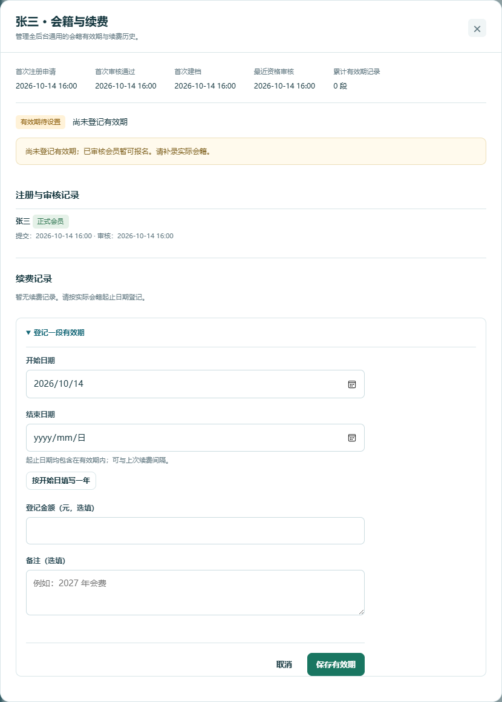

图 6 · “续费记录”中填写起止日期，保存一段有效期。 [查看大图 ↗](../app/static/guide-images/admin-membership.png)

### 把职责交给合适的人

后台管理员在**人员中心 → 角色与权限**选择已审核会员，勾选角色并保存。可以兼任多项；取消管理角色不影响会员资格。

**后台管理员**：全部管理职责，含角色授予与撤销。

**会员管理员**：会员审核、资料、等级、组别及会籍。

**活动管理员**：活动时段、报名条件、提醒与统计。

**赛事管理员**：每日趣味赛、大型赛事及比赛管理。

**消息管理员**：编辑、发布群消息。

**机器人管理员**：机器人、群通道及负责范围。

**系统管理员**：系统及 AI 设置。

查看本人职责：`我的权限`。赛事负责人、记分员、协调员在具体赛事内单独配置。

打开角色与权限 →（后台 `/admin#roles`）

看图操作：角色与权限

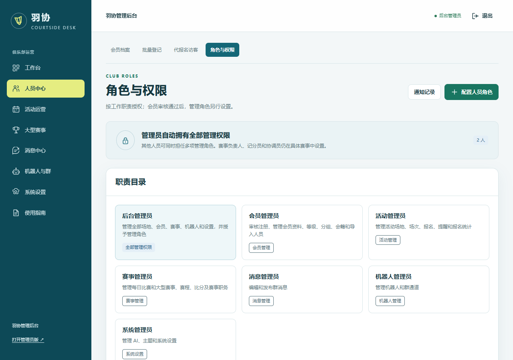

图 9 · 选择已审核会员配置管理职责；会员资格与管理角色分开。 [查看大图 ↗](../app/static/guide-images/admin-roles.png)

### 注册与通知问题：按现象处理

| 现象 | 管理员检查与操作 |
| --- | --- |
| 导入后仍显示“待本人确认” | 这是已核准名册，尚未关联群账号。已有会员用“匹配已有会员”；其他人用“通知本人确认”。 |
| 补手机号时提示已有人员或绑定冲突 | 同名同手机号的已注册会员可关联。姓名不同、手机号冲突或已绑他人时先核对档案，不反复新增。 |
| 成员称已导入，仍出现待审核 | 核对姓名是否与名册一致；回调未带姓名时用“注册确认 张三”。重名补手机号，必要时在档案中核对。 |
| 名册只有手机号，成员不知道如何确认 | 可先“补全资料”补姓名；也可让本人在注册链接填写姓名、性别和登记手机号，手机号唯一匹配后关联。 |
| 注册链接缺失或无法打开 | 检查“系统设置 → 账号与服务 → 公共服务地址”是否正确且可访问。保存后让成员重新发送“注册”，使用新链接。 |
| 找不到资料调整申请 | 在“会员档案”点“申请待审”，找到该会员的“审核资料”；无需另找独立页面。 |
| 选不到通知机器人 | 检查该机器人已启用、开启会员注册、接收群指令，并连接可发送的群。 |
| 提示“请重新预览通知后发送” | 重新打开通知窗口，核对人员与机器人，点击“预览通知”再发送；修改发送群或名单后须重新预览。 |
| 审核成功但群里没收到通知 | 先查会员资格和“通知记录”。检查原申请机器人及连接是否可用、是否开启会员注册，再处理页面允许重试的通知。不要重复审批。 |
| “待发送 / 已发送 / 结果待确认” | 待发送先等队列；已发送表示接口已接受；结果待确认先核对群里是否收到，避免重复发布。 |
| 成员已通过仍不能报名 | 查会籍是否覆盖活动日期，再查机器人业务、用户条件、场地场次、开放时间及活动组别/等级要求。 |

## 日常活动与报名

### 场地、场次与报名日历

1. 在**活动运营 → 场地规划**维护场地名称、位置与启停状态。
2. 在**活动时段**在**周期性时段**新增或编辑规则，填写星期、名称、起止时间、正式及替补人数，选择是否**跳过节假日**，再勾选应用场地。相同规则可同时用于多块场地。
3. 临时加场或改时间，切换到**非周期性时段 → 新增日期安排**，选择日期和场地后保存；也可恢复该日原有周期或节假日安排。
4. 打开**报名日历**先看日期格内的报名人数、正式/替补进度条、场次及场地数量。周末、节假日、调休上班日、比赛日有独立标记；选中日期后按场地查看各场次，展开单场名单；可筛选场地、状态、名称或时间，每页最多12场。未结束场次可添加、取消报名或调整人数和报名条件；历史报名只读。

改时段会调整尚未开始的未来安排和预约；历史及已开始场次保留原时间。赛事锁定的场次需先处理赛事。

打开报名日历 →（后台 `/admin#calendar`）

看图操作：日历与活动时段

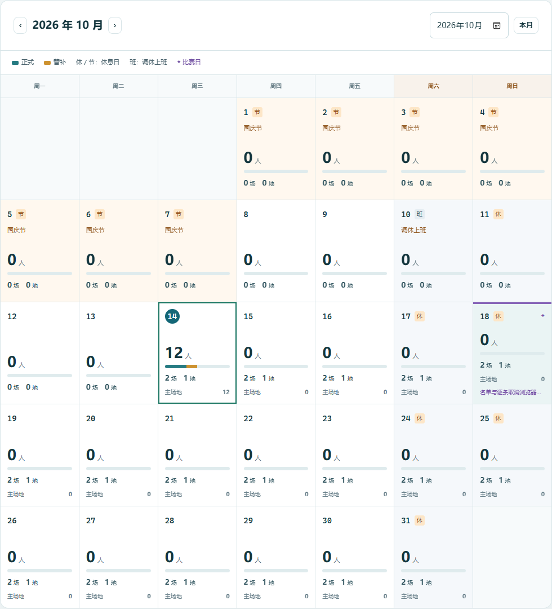

图 10 · 月历显示人数、场次、场地数及周末、节假日、比赛日标记。 [查看大图 ↗](../app/static/guide-images/admin-calendar.png)

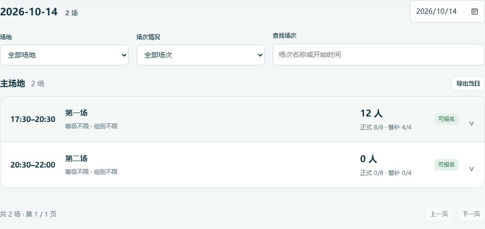

图 10b · 选中日期后按场地查看场次，再展开对应名单。 [查看大图 ↗](../app/static/guide-images/admin-calendar-day.png)

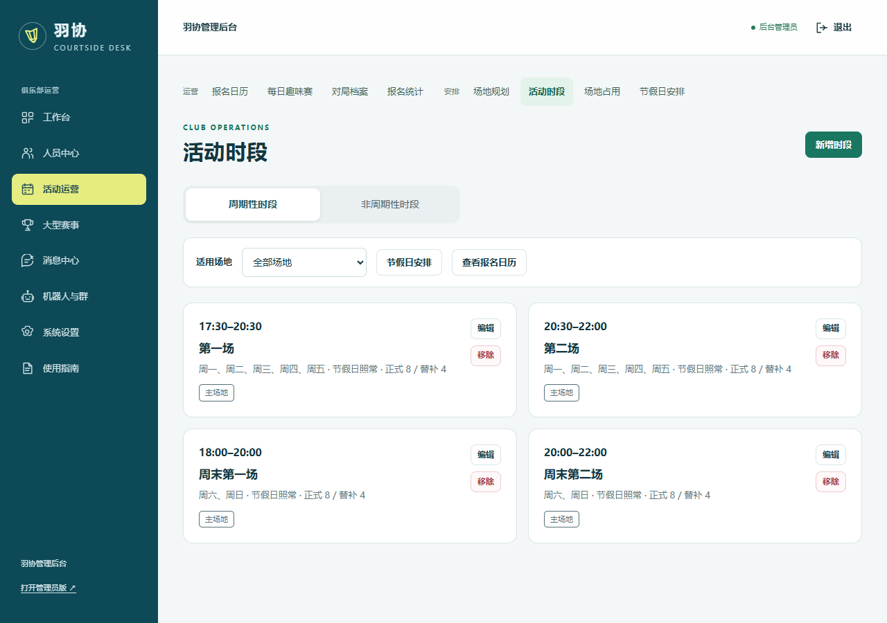

图 11 · 周期性时段与非周期性时段分开维护。 [查看大图 ↗](../app/static/guide-images/admin-sessions.png)

### 登记其他活动占用

1. 进入**活动运营 → 场地占用**，在页面内选择场地。
2. 点击**登记占用**，填写用途、日期、开始和结束时间并保存。训练、维修、借用等均可登记。
3. 日历和相关机器人显示不可报名；与该时段重叠的整个日常场次暂停新报名，已有报名保留。可在日历查看受影响名单并协调。
4. 需要撤销时点击**释放**；未开始的其他活动占用可以编辑。大型赛事占用请到赛事页面调整。

同一场地的两项占用不能重叠。占用登记或释放后，开启活动提醒的相关群会收到通知；同一实际群只发一次。

具备活动管理权限且机器人开启群内管理时，可发送 `场地1 明天 占用 17:30-20:30 校队训练`、`场地1 释放占用12`。编号从占用查询中获取。

AI示例：`AI 明天场地1从17点半到20点半安排校队训练占用，再查看占用情况`；核对步骤后回复“确认”。

管理场地占用 →（后台 `/admin#occupancies`）

### 逐个安排节假日

1. 进入**活动运营 → 节假日安排**，选择场地和年份。点击**获取 / 更新节假日**加载当年的假期列表。
2. 展开一个假期，核对开始、结束日期，设置各场的名称、起止时间、正式和替补名额。
3. 勾选**使用本假期专用场次**并保存。启用但移除全部时段表示假期暂停日常报名；关闭时按周期规则执行，其中勾选“跳过节假日”的规则不执行。
4. “非周期性时段”指定日期的安排优先。机器人若只负责部分场次，在**机器人与群**中选择相应假期场次。

刷新年度数据保留手工安排；已结束的假期只读。已有预约或赛事锁定导致无法切换时，按提示保留原场次后调整。

群中管理命令：`节假日设置`查看当年假期；`开启节假日` / `关闭节假日`批量开关本场地的假期专用安排。

配置节假日安排 →（后台 `/admin#holidays`）

## 举办大型赛事

### 办赛前：确定项目、人数和人员

先确定比赛日期、场地、预计人数、单打或双打；双打再选普通双打、男双、女双或混双。确定负责人、记分员和协调员。

积分赛适合循环交手；单淘汰和双败淘汰适合晋级比赛；分组淘汰先小组循环再淘汰。五人转、五羽伦比、双打轮转适合相应人数和组队形式。

创建时会提示赛制适用条件；具体轮转和人数说明见[每日赛事赛制说明](MEMBER_GUIDE.zh-CN.md#competitions)。

### 1. 创建赛事草稿

1. 进入**大型赛事 → 组织大型赛事**，在创建表单中选择比赛场地和占用起止时间。
2. 填写赛事名称、日期、比赛项目、赛制和**群报名关键词**，例如赛事名“春季联赛”、关键词“春季联赛”。
3. 设置报名开始/结束时间、组别与等级要求；分组淘汰同时检查分组数、每组晋级人数。
4. 选择组队算法、计分参数后保存。先核对草稿，再开放报名。

大型赛事有独立报名期，关联日常活动场次为可选项。文字“规则说明”用于补充规程，计分参数需在赛事设置中填写。

打开大型赛事 →（后台 `/admin#tournaments`）

### 2. 指定负责人和负责机器人

1. 打开赛事的**组织与协调**，填写赛事介绍、规则说明、集合与到场安排。
2. 在**负责机器人与通知群**勾选接收群并保存。可选多个机器人；同一次通知每个实际群只发一份。
3. 在**人员职务**选择已审核会员，分别指定负责人、记分员、协调员和授权起止时间，保存。

候选机器人应已启用**大型赛事**、负责赛事场地并连接可发送的群。日常场次限制不影响大型赛事。未选通知群时，后台建赛不会自动发群消息。

看图操作：赛事工作室

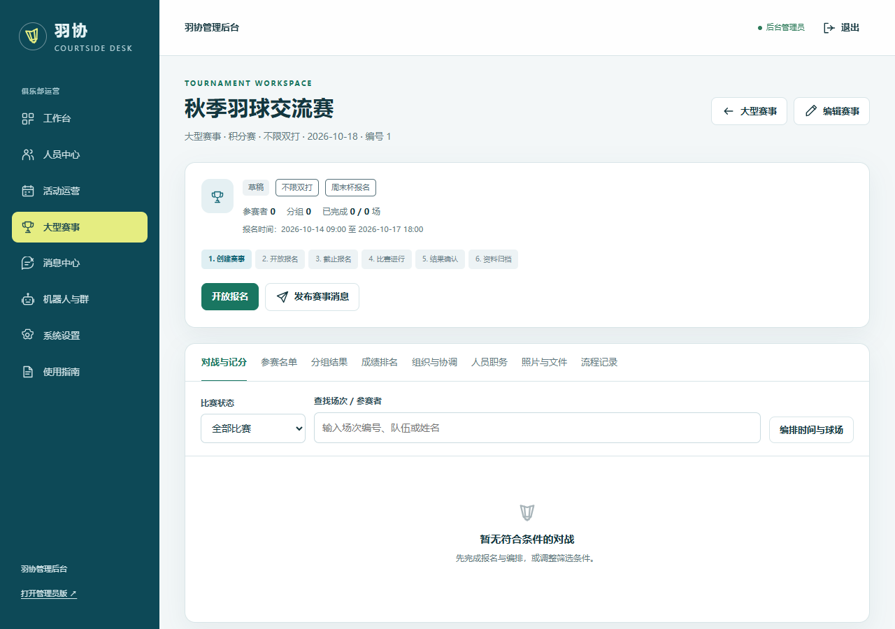

图 12 · 从赛事阶段进入“组织与协调”，配置说明、通知群与人员职务。 [查看大图 ↗](../app/static/guide-images/admin-event.png)

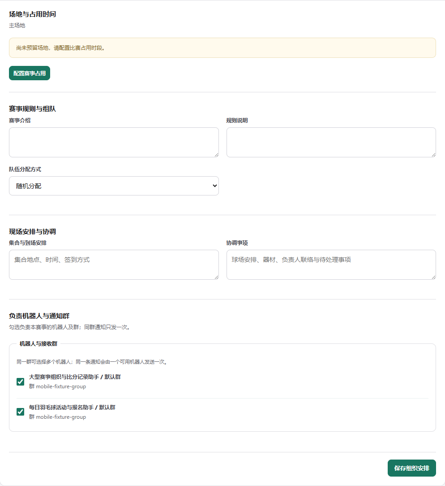

图 12b · 在“组织与协调”填写规则、集合安排并选择负责机器人，点击“保存组织安排”。 [查看大图 ↗](../app/static/guide-images/admin-event-organization.png)

### 3. 开放报名并发群公告

1. 点击**开放报名**，状态进入“报名中”；用户报名仍须在所设时间窗口内。
2. 用**发布赛事消息**选择报名通知，核对接收群后发送。
3. 在参赛名单中查看新增人员；在发送记录中核对公告结果。

发送、反馈与下一步

**你发送**：`春季联赛报名`

**机器人反馈 · 节选**：返回赛事报名结果和当前参赛名单。

**下一步**：会员按公告关键词报名；查询赛程、规则使用实际赛事名称。

报名通知未发出时先查看发送记录，避免反复点击。参赛者代报与取消的用法可直接分享[普通用户版 · 参加大型赛事](MEMBER_GUIDE.zh-CN.md#events)。

### 4. 结束报名，核对名单

1. 截止后查看状态；需要提前截止时点击**结束报名**。
2. 核对参赛人数、性别、组别、等级和队伍配置，处理名单疑问。
3. 发布**报名结束**通知，告知成员等待分组与赛程。

报名截止后不能再按报名指令新增或取消人员。请在抽签前确认名单和规则；人数不足时先解决参赛规模，再继续编排。

### 5. 抽签分组并排赛

1. 确认“报名结束”后点击**随机分组与编排**，确认后**生成对战表**，生成队伍、分组和对战表。
2. 在“对战与记分”点击“编排时间与球场”，填写每场时间和球场后保存。
3. 检查球场、开赛时间和上场顺序，给转场与休息留出时间。
4. 发布分组结果和赛程，提醒球友查询自己的安排。

组队可选随机、种子分布、平均分布或高带低；五人转按固定轮转规则。生成对战后不要重新组织一场同名比赛；保留本次对阵继续办理。

发送、反馈与下一步

**你发送**：`春季联赛，我的赛程`

**机器人反馈 · 节选**：列出本人参与的对局、对手及已安排的时间和球场。

**下一步**：参赛者按安排到场；赛程调整后由负责人员再次通知。

### 6. 开赛、记分与改分

1. 完成排赛后点击**开始比赛**。
2. 指定记分员按对战表左右顺序登记比分；赛事负责人或管理员可修正已有比分。
3. 每次提交后核对返回的对战表；记分权到期或人员换班时，在人员职务中调整。

发送、反馈与下一步

**你发送**：`春季联赛，第2场21:19`

**机器人反馈 · 节选**：对战表显示：王明，张三（21）VS 李四，赵六（19）。

**下一步**：先核对场次和双方顺序。录错时由负责人重新提交这场的正确比分。

协调员维护安排，不负责记分；普通参赛者可查看赛程和成绩。比分支持21:19、21：19、21-19，场次支持中文或阿拉伯数字。

### 7. 暂停、继续与晋级

暂时中断使用**暂停**，之后恢复原赛事，保留分组和比分。群内也可发送：

- `春季联赛，暂停比赛`
- `春季联赛，恢复比赛`
- `春季联赛，积分表`

小组赛完成后按规则晋级。出线边界完全同分时，由负责人点击**同分抽签并晋级**，完成有记录的抽签。

若后续晋级比赛已经开始，上游改分可能受限；先核对赛程关系。终止整项赛事才用**关闭**，关闭不能恢复，也不会为未完赛事判冠军。

### 8. 发布赛果与归档

1. 全部比赛结束后，核对积分、胜负及最终获胜者。
2. 发布成绩通知，提醒参赛者查询 `春季联赛，积分表`。
3. 在赛事工作室上传比赛照片和文件，整理赛程及协调记录。
4. 完成核对后**归档**，以后从历史赛事查看；归档后不再继续报名或记分。

长周期赛事途中只需暂停和恢复；归档留到所有赛果、照片及资料整理完成后。

### 每日趣味赛怎么管理

当前每日趣味赛与大型赛事采用羽毛球规则。其他类型场地可先使用通用活动报名。

日常约球由已报名会员在群内发送“组织比赛”，再选择可用赛制；发起人就是组织者。无需为每次日常约球新建大型赛事。

管理员在**活动运营 → 每日趣味赛**查对战、修正比分、暂停或恢复赛事；需更换记分人员时调整本人员职务。

[查看普通用户版 · 每日趣味赛 →](MEMBER_GUIDE.zh-CN.md#competitions)

### 先预留比赛场地与时间

创建大型赛事时，先选择**比赛场地、活动日期、占用开始与结束**，再填写赛事名称、赛制和报名窗口。报名窗口不是场地占用时间。

赛事草稿创建后即预留场地；日常场次显示占用并暂停新报名。若与其他已登记活动冲突，调整时间或先释放原占用。

多日赛事或后续调整：打开**组织与协调 → 配置赛事占用**，逐段添加日期和起止时间。安排具体对局时，开始时间应在赛事预留范围内。已开始的占用保留历史；关闭或归档赛事释放预留，暂停比赛仍保留场地。

旧赛事若提示“尚未预留场地”，请补充占用时间后再开展活动。

## 消息、AI与系统

### 提醒与群消息

**定时播报：**进入“机器人与群 → 机器人管理”，展开要配置的机器人，在其下方**定时播报**面板添加规则。选择消息内容与北京时间，展开日期条件可设置起止日期、星期、工作日（含调休）、周末及节假日条件，点击**保存定时播报**。无需再次选择机器人；规则可停用或删除。“系统设置 → 账号与服务”保留全部机器人的播报总开关。同群同一时刻的相同内容只发一次。

修改一个机器人的播报不会改动其他机器人。保存提示已被修改时，点击**重新载入播报**，核对最新规则后再编辑。

按节假日执行前，先在“节假日安排”获取当年日历。未获取年份不执行依赖节假日的规则。

**临时通知：**进入“消息中心”，选接收群，编辑文字、添加图片或文件，获取预览后确认发布。

发完到“发送记录”检查结果；已加入队列时先等待，结果待确认时先核实群里是否收到。

图片、文件上传完成后再发送。一次选中同群的多个机器人，也只发送一份。

打开消息中心 →（后台 `/admin#messages`）

看一段实际使用示例

**网页操作**

选接收群 → 编辑文本、图片或文件 → 预览 → 确认发布。

进入发送记录：**“待发送”**表示已排队；**“已发送”**表示发送接口已接受，不代表群成员已阅读。**“结果待确认”**时先看群里是否收到，不要直接再发一遍。

定时消息分报名提醒、截止提醒和名单播报，时间以管理员设置为准。收到报名提醒不代表本人已经报名，仍需发送“报名”。

看图操作：定时播报与临时消息

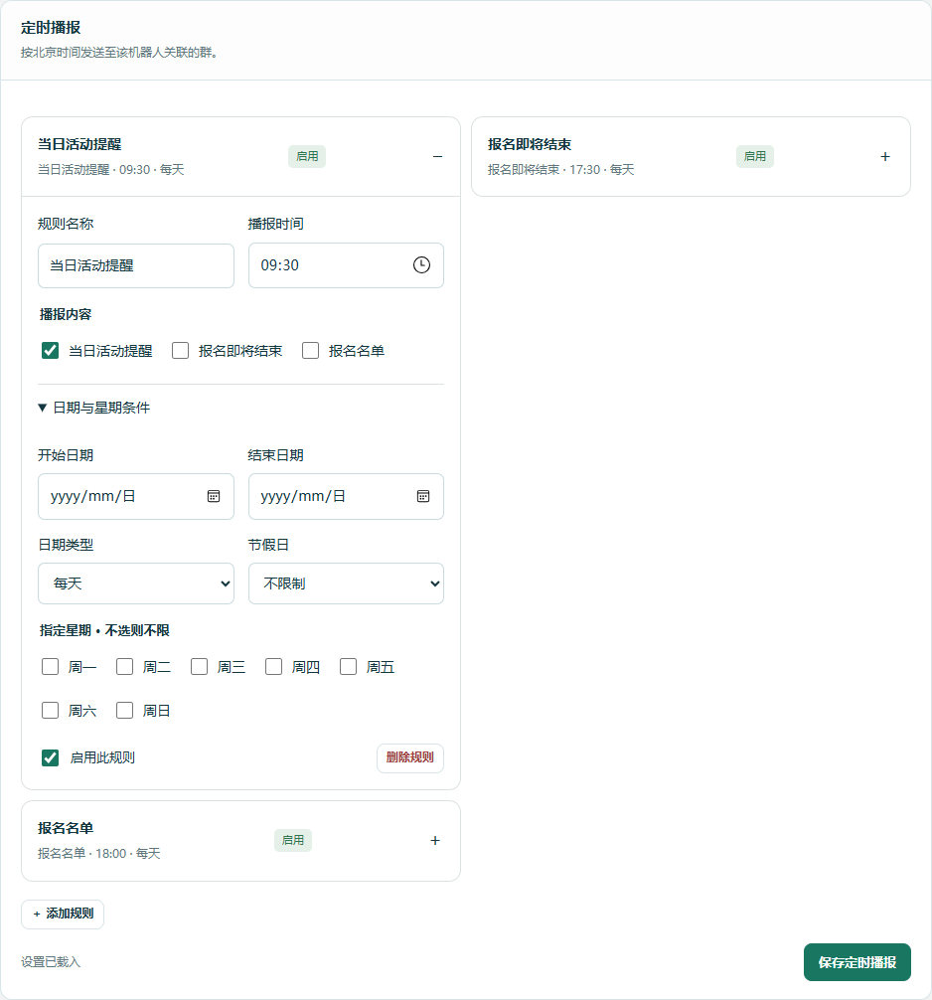

图 13 · 展开机器人，在其定时播报面板配置内容、时间和日期条件。 [查看大图 ↗](../app/static/guide-images/admin-reminders.png)

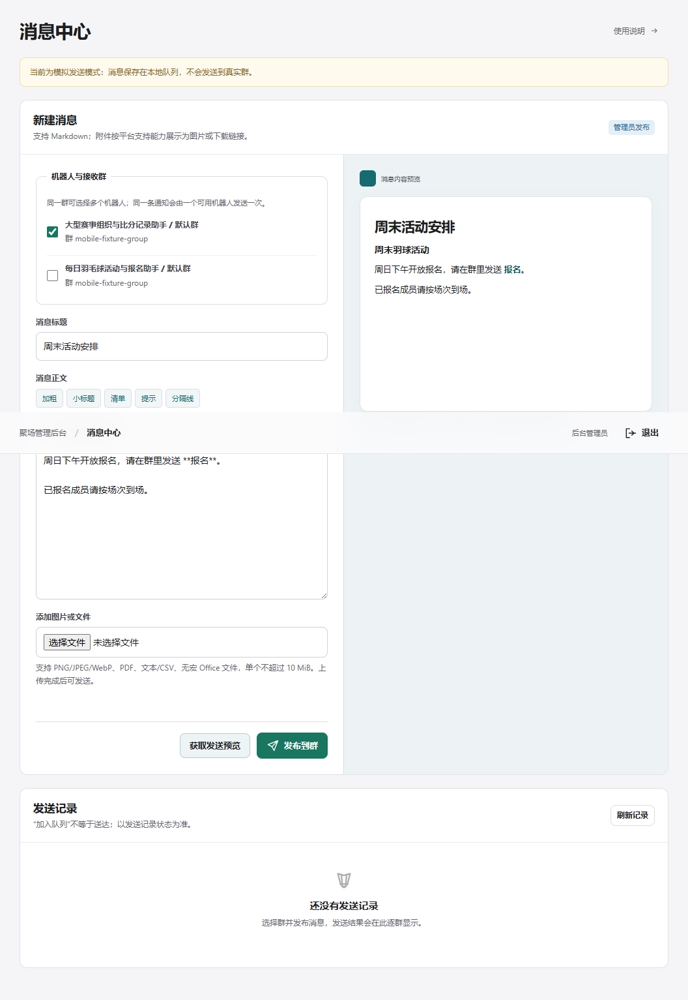

图 14 · 临时消息先选择接收群，编辑内容后预览发布。 [查看大图 ↗](../app/static/guide-images/admin-messages.png)

### AI：开启、配置和日常办理

1. 进入**系统设置 → AI设置**，填写平台配置、选择模型并开启AI。
2. 进入**机器人与群 → 机器人管理 → 编辑名称与功能**，为需要的机器人勾选“AI助手”。
3. 在AI设置填写**待确认方案有效期（分钟）**，默认5分钟。

发送、反馈与下一步

**你发送**：`AI 明天第一场正式12人替补4人，再把报名提醒改成10点`

**机器人反馈 · 节选**：按1、2列出要调整的活动和提醒；尚未执行。

**下一步**：核对后回复“确认”；需要调整则发送“AI 提醒改为9点半，其他不变”，核对新的步骤后再确认。

“AI进度”看结果，“取消计划”放弃当前方案。每位用户只有一份当前方案；操作范围按本人已有管理职责办理。

打开AI设置 →（后台 `/admin#ai`）

### 统计、账号与操作核对

**活动运营 → 报名统计**查询历史汇总及导出。群内管理身份可发 `统计`；普通会员发“我的统计”。

**系统设置**修改网页登录密码；换密码后重新登录。需要核对修改记录时查看操作记录。

“对话演练”可按会员身份检查回复。演练不发群消息，但报名、取消和记分仍会写入实际业务，检查文案时先用“帮助”“注册资料”等查询。

打开报名统计 →（后台 `/admin#stats`）

## 常见问题处理

### 接入与通知问题

**@机器人后没有回复**：先确认@目标机器人。检查机器人和群连接是否启用、是否接收指令；在机器人平台核对本机器人的回调地址，再检查发送Webhook。保存后以“帮助”验证。

**群里有两个机器人，只有一个响应**：两个机器人分别使用自己的发送Webhook和回调地址；在连接编辑中选择同一个群。个人申请的审核结果由发起申请的机器人发送，需开启“会员注册”；该机器人停用时保持待发，管理角色变更由“群内管理”机器人发送；报名、赛事和普通公告按业务范围共享，同群只发送一次。

**一直显示“等待群内验证”**：核对后台发送地址和机器人平台回调地址属于同一个机器人，保存后回到所选群 @它发送“连接”。可在后台点击“查看连接状态”，分别检查发送和接收是否已验证。

**机器人提示“未开启”或场次不在负责范围**：编辑机器人的业务和场地/日常场次；群连接无需再配置活动范围。发送“帮助”核对最新业务。

**AI全局已开启，机器人仍不能用**：还需在这个机器人的业务中勾选“AI助手”，然后@它发送“AI状态”。

### 办赛时遇到这些提示

**选不到负责机器人**：检查机器人已开启大型赛事、负责赛事场地、已连接启用的群并配置发送Webhook，再回赛事的组织与协调选择。

**尚未开放报名 / 报名已结束**：检查赛事状态和起止时间；仅填写时间没有开放报名时，先执行“开放报名”。已抽签后不能更改报名窗口。

**不能抽签 / 人数或性别不满足**：先结束报名，再核对所选赛制的最低人数、组队要求和性别资料。已生成对战时继续原赛事，不重新抽签。

**无本赛事记分权限 / 尚未开放记分**：检查用户已审核、人员职务及授权期，再检查赛事是否已开赛、该对局是否就绪。普通参赛者不会自动获得记分权。

**排赛冲突 / 尚不能晋级**：检查相同球场与开赛时间；分组淘汰需先完成小组赛，出线同分按页面提示办理。不同时间但时长重叠的比赛也要人工核对。

**页面数据已变化**：刷新赛事页面，重新核对名单、状态与安排后再提交，避免把别人刚改的内容覆盖。

### 管理员发送与通知记录

**“待发送 / 发送中”**：消息正在排队或发送，稍后刷新发送记录，不要反复点发布。

**“已发送”**：平台已接受消息；可到群里核对，状态不代表成员已读。

**“失败”**：查看发送记录中的原因，修正机器人发送地址、附件或配置后，再按页面可用操作处理。

**“结果待确认 / 部分发送”**：先核对群里已收到哪些内容；未确认前不要整条重复发送，必要时只补发缺失部分。

**身份通知待处理、受阻或群绑定不可用**：审核结果可能已经生效。先核对会员状态。个人审核结果请检查原申请机器人的发送连接及“会员注册”；管理角色变更请检查“群内管理”机器人；仅对页面允许重试的通知重试。
