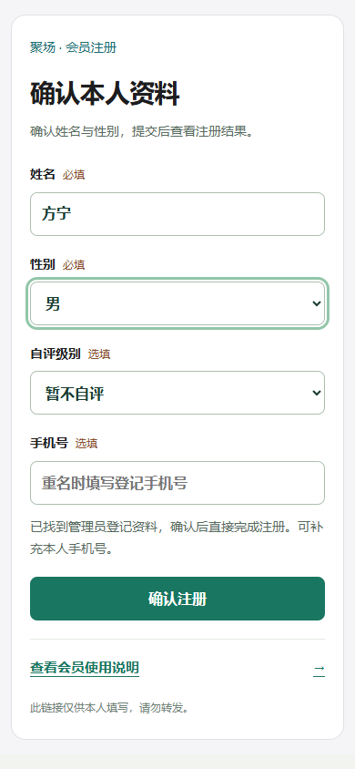
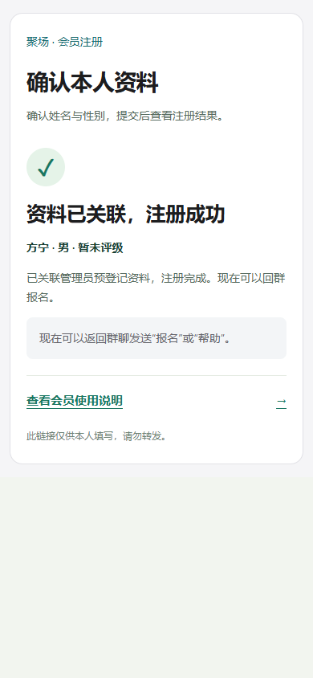
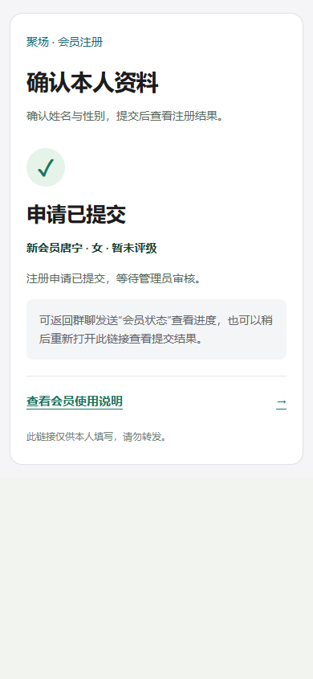
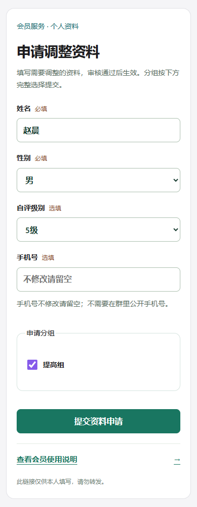

# 聚场 · 普通用户操作说明

v1.0 · 2026-10-26 · 网页版：`/guide/member`。

网页按任务展开，支持搜索和复制指令。示例姓名、日期请按实际替换；截图使用虚构数据。

## 注册与开始使用

### 先看机器人能做什么

在群里 @要使用的机器人，发送 `帮助`。不同机器人可能负责不同业务、场地或场次。

第一次使用先注册；完成名册关联或审核通过后，按日期和场次报名。同一后台内换群不用重新注册。

群内发送“帮助”，查看当前机器人可用功能。

### 从注册到开始使用

1. **在群里取本人链接**：@负责注册的机器人，发送 `注册` 或 `注册确认`。如果未带出姓名，可发送 `注册确认 张三`。
2. **核对资料并提交**：打开链接，填写姓名、选择性别；手机号和自评 1–9 级选填。使用本人链接提交。
3. **看页面结果**：已导入姓名唯一匹配：点击“确认注册”，直接完成。没有匹配：点击“提交注册申请”，等待审核。
4. **回群开始使用**：`注册资料` 查状态；通过后发送 `帮助` 查看当前机器人支持的功能，再报名。

管理员已导入名册时，**确认同名资料即可注册**，不再审核会员资格；重名时填写登记手机号区分。等级、组别留空不影响注册，新提交的自评级别另行审核。

链接失效时，回群发送“注册”获取新链接。

页面示例：确认资料 → 查看结果

图 1 · 核对姓名和性别，匹配名册后点击“确认注册”。 [查看大图 ↗](../app/static/guide-images/member-confirm.png)

图 2 · 显示“资料已关联，注册成功”，可回群使用已开通的业务。 [查看大图 ↗](../app/static/guide-images/member-confirmed.png)

图 3 · 未匹配名册时显示“申请已提交”，等待会员管理员处理。 [查看大图 ↗](../app/static/guide-images/member-pending.png)

群里和网页分别会收到什么

**你发送**：`注册确认`

**机器人回复**：本人资料填写链接。

**网页结果**：“资料已关联，注册成功”或“申请已提交”。以此结果判断是否还需审核。

需要审核的申请，通过或退回后由**发起申请的注册机器人 @本人通知**。通知暂未收到时，先查“注册资料”；不必重新注册。

### 注册与姓名匹配的不同情况

| 你看到的情况 | 怎么做 | 接下来 |
| --- | --- | --- |
| 管理员导入过，姓名唯一匹配 | 核对姓名、性别后确认；手机号与自评级别可补填。 | 直接关联并完成注册。 |
| 名册只有手机号、没有姓名 | 填写本人姓名、性别和已登记手机号。 | 手机号唯一匹配且未绑定他人时完成关联。 |
| 同名多人 | 填写管理员名册中登记的本人手机号。 | 唯一匹配后关联；仍无法区分时联系管理员核对。 |
| 没找到自己的姓名 | 确认没有错字，按真实姓名填写，不借用他人资料。 | 提交正常申请，等待审核。 |
| 手机或账号已有绑定、资料冲突 | 把提示交给管理员核对原档案。 | 不会自动换绑到其他人的账号。 |
| 提示“已注册” | 无需再申请；用“注册资料”查看，修改资料走本人资料申请。 | 同一后台换机器人或群不用重复注册。 |
| 申请待审、申请退回 | 待审时查询进度；退回后按备注修改，重新提交。 | 审核完成后再使用会员业务。 |
| 已停用 | 联系管理员处理。 | 重复注册不会恢复资格。 |
| 没有姓名或链接已失效 | 发送“注册确认 张三”补充姓名；失效时重新取本人链接。 | 使用最新链接提交。 |

“已注册”是会员身份；“正式 / 替补 / 候补”是某场活动的名额。代报名同行不会因进入正式名额自动成为会员。

### 一句话告诉助手

固定指令直接发送；用自然语言时，在前面加 **AI**。可以把连续几件事一起说。

- `AI 明天第一场帮我占个位，再看那场名单`

查询直接返回；需要修改时，先核对机器人给出的预览，回复 **确认**。

需要表单时，打开返回的链接填写。发送 `AI状态` 查看是否开启；发送 `帮助` 查看群内简明说明。

看一段实际使用示例

**你发送**：`AI 明天第一场帮我占个位，再看那场名单`

**机器人回复**：**AI 计划待确认 · 尚未执行** 1. 本人报名：明天第一场。 2. 查询名单：明天第一场。 回复“确认”执行；修改请发送“AI 改为第二场”。

**下一步**：核对日期、场次及每一步，回复“确认”执行。修改请发送“AI + 修改意见”，核对新的完整步骤后再确认。

确认后会显示**“AI 计划已完成”**及各步业务结果。

不想办理就发送“取消计划”；查询执行状态用“AI进度”。确认、取消和查询须由本人在原机器人、原群进行。

## 报名、预约与资料

### 修改资料、等级和组别

1. 发送 `修改资料` 或 `补全资料`，打开本人表单。
2. 修改姓名、性别、手机号、自评级别或分组，提交申请。分组按**希望保留的完整组别**选择。
3. 发送 `我的资料申请` 查看进度；不再修改可发 `取消资料申请` 撤回。

也可直接发送 `申请分组 提高组`、`申请等级 5级`。审核前原资料继续生效，通过或退回后由原申请机器人 @本人通知。

页面示例：本人资料调整表单

图 4 · 修改后提交资料申请，管理员审核后生效。 [查看大图 ↗](../app/static/guide-images/member-profile.png)

[查看注册与关联的常见情况 →](#registration-cases)

### 当天报名

名单按场次显示，时间段单独一行。可报名的空场次提示“暂时无人报名，欢迎报名参与！”；有人报名后显示名单及名额，图片只显示表格。

- 报本人 `报名`

- 报名并显示完整名单 `报名 接龙`

- 追加两位具名同行 `报名，张三，李四`

- 追加两位未具名同行 `报名+2`

- 查看正式、替补和候补 `名单`

- 仅取消本人 `取消报名`

- 取消自己代报的指定同行 `取消张三，李四`

本人重复报名不重复占位；带人报名每次追加，原同行保留。“报名+2”每次新增2人。已代报同名同行时，本次不会添加，请先查名单。

名单显示姓名、性别、名额（正式 / 替补 / 候补）。同行显示“张三（本人姓名代报名）”，不会自动成为会员，性别显示未填写。取消本人保留同行；取消同行后按顺序递补。

看一段实际使用示例

**你发送**：`报名，张三，李四`

**机器人回复**：**报名已确认**：日期、起止时间、场地。 当前本人及2位代报名人员。

**下一步**：核对返回的场次与三个人的名额；发送“名单”看完整名单。

| 姓名 | 性别 | 名额 |
| --- | --- | --- |
| 王明（3级） | 男 | 正式 |
| 张三（王明代报名） | 未填写 | 正式 |
| 李四（王明代报名） | 未填写 | 替补 |

“正式 / 替补 / 候补”表示这场活动的名额，**不表示会员身份**。同一条回复里的代报访客也可能占正式名额。

**你发送**：`取消报名`

**机器人回复**：已取消本人报名，后续报名已依次递补。 你代报名的2人仍保留。

**下一步**：若李四也不来，再发送“取消李四”；要取消两位同行，发送“取消张三，李四”。

只想带人、不保留本人时：先带人报名，再“取消报名”。本人已取消后再次发送“报名+2”，会恢复本人报名并新增两位同行。

### 预约指定日期与场次

- 明天第二场 `明天第二场报名`

- 指定日期、场次 `2026-11-08 第二场 报名`

- 按开始时间选择 `2026-11-08 18:00 报名`

- 查询某一天 `2026-11-08 名单`

- 仅取消本人预约 `2026-11-08 第二场 取消报名`

- 取消指定日期的同行 `2026-11-08 第二场 取消张三，李四`

- 指定场地 `场地2 第1场 报名`

日期、时间、场地编号按实际安排填写。若有等级、组别或会籍要求，机器人会提示未满足的条件；提醒时间不是报名开放时间。

看一段实际使用示例

**你发送**：`2026-11-08 第二场 报名`

**机器人回复**：**报名已确认**：返回实际匹配的日期、起止时间、场地及个人名单。

**下一步**：先核对时间。若不是预期场次，用同一日期和场次发送“取消报名”，再选择正确场次。

若提示**“未找到唯一可用场次”**，看回复里的可用安排，再补上日期、场次或时间；这次尚未报名。

### 资料与会籍

- 会员资格与等级 `注册资料`

- 提交等级申请（1–9级） `自评3级`

- 补齐或更正性别 `性别 女`

- 有效期与续费记录 `我的会籍`

自评级别由管理员审核后显示。会籍到期或两次续费的间隔期不能新增报名，仍可查历史、取消已有报名；续费联系管理员。

看一段实际使用示例

**你发送**：`自评3级`

**机器人回复**：已提交自评3级，等待管理员审核。

**下一步**：“注册资料”可见待审核的自评申请；提交申请不等于已经获评3级。

**你发送**：`我的会籍`

**机器人回复**：返回当前会籍状态和起止日期；没有登记时提示尚未登记有效期；已审核会员当前仍可报名，请联系管理员补录实际会籍。

**下一步**：到期或预约日期不在有效期内，联系管理员登记续费后重新报名。

等级审核通过会 @你通知当前级别；未获评时显示“无级别”。会员注册审核和等级审核分别办理。

### 场地被占用时

大型赛事、训练等活动预留场地后，名单和提醒会显示**已占用 · 不可报名**。即使只占用场次的一部分时间，该场次也暂停新增报名。

已报名人员保留在名单中，请留意管理员调整；仍可发送 `取消报名`，或按姓名取消自己代报的同行。

`明天 场地占用` 查询安排；多个场地可发送 `场地2 明天 场地占用`。机器人只显示它负责的场地和时段。

报名失败后怎么办

**你发送**：`明天第一场报名`

**机器人回复 · 示例**：该场次已占用，不可报名或组织每日比赛：校队训练（17:30–19:00）。

**下一步**：发送“明天 名单”，选择其他可报名场次；占用释放后可重新报名。

节假日场次可能与每周安排不同，以当天名单所示时间为准。

## 每日趣味赛

会员可发起

### 每日趣味赛

1. 先报名，再发送 `组织比赛`。机器人会列出人数及可用赛制。
2. 需要指定项目，可发送 `组织比赛 混双`；也支持单打、双打、男双、女双。
3. 回复可用赛制，例如 `积分赛`，生成对战表。
4. 发起人是组织者，负责记分、改分与暂停；完赛后查看积分表和赛果。

默认普通双打。正式人数不足时，可按顺序补入符合条件的替补。混双每队一男一女，男双、女双须符合性别要求。

调整组队方式与赛事名称

开始策划时可以加名称：

- `组织比赛 双打 周末双打`

选赛制前，可发送以下一种分配方式：

- `分配 随机`
- `分配 种子分布`
- `分配 平均分布`
- `分配 高带低`

五人转使用固定公平轮转，仅支持随机排位。

看一段实际使用示例

**你发送**：`组织比赛 双打 周末双打`

**机器人回复**：**每日策划 · 双打** 当前符合条件：正式人数、替补人数。 随后列出“赛制 / 当前状态 / 最低人数”。

**下一步**：只选择显示“可组织”的赛制，例如“积分赛”；人数不够时先补齐报名或改用支持的项目、赛制。

回复赛制后会生成**对战表**。发起人就是组织者，其他普通会员可查安排；不是所有参赛者都能记分。报名由其他机器人办理也可以，只要对应场地、场次的数据已在后台。

### 查对战表、记分与继续比赛

- 完整对战安排 `周末双打，对战表`

- 个人上场安排 `周末双打，我的赛程`

- 记录第2场比分 `周末双打，第2场21:19`

- 排名与成绩 `周末双打，积分表`

- 暂停，保留进度 `周末双打，暂停比赛`

- 恢复这场比赛 `周末双打，恢复比赛`

场次支持“第二场”“2”等写法，比分支持 **21:19 / 21：19 / 21-19**。先核对对战表左右顺序再记分；不要把活动场次当成对局编号。

谁能记分？找不到未结束的比赛怎么办？

普通会员可以查看。组织者、赛事负责人和赛事管理员可以记分、改分及控制赛事；指定记分员在授权期内登记新比分。大型赛事普通参赛者不因参赛自动获得记分权。

发送 `继续比赛` 查找人员匹配的未结束赛事；有多场时按返回选项选择。彻底结束可用 `周末双打，关闭比赛`，关闭后保留历史，不能恢复。

看一段实际使用示例

**你发送**：`周末双打，第2场21:19`

**机器人回复**：返回更新后的对战表，显示这一场双方姓名、比分与状态。

**下一步**：核对左右队伍和比分；录错时由组织者或管理员重新提交该场正确比分。

| 场次 | 对战及比分 | 状态 |
| --- | --- | --- |
| 2 | 王明，张三（21）VS 李四，赵六（19） | 已完成 |

最后一场完成后会附积分或赛果；“周末双打，积分表”可再查看**组别、排名、成员、场次、胜负、净胜分**等信息，获胜者按赛制显示。

**你发送**：`继续比赛`

**机器人回复**：有多场时：“存在多场未结束赛事，请选择”，并逐项给出“继续比赛 编号 · 赛事名称”。

**下一步**：复制目标赛事前面的“继续比赛 编号”，不要另写“选择1”。暂停和关闭不同：关闭后不能恢复。

### 选一种合适的赛制

发送“组织比赛”后的可用列表，会按当前人数、项目和性别组合筛选。

#### 积分赛

单打或固定双打，每对对手交手一次；按胜场、局净胜、分净胜排名。

#### 五人转

恰好5人、5场双打。每人打4场、轮空1场，每对搭档合作1次，按个人排名。

#### 双打轮转

4–40人轮换搭档，优先安排出场较少者；按个人成绩排名。

#### 五羽伦比

至少10人、人数为5的倍数。每队5人轮换搭档，默认团队50分追逐赛；登记团队总比分。

#### 单淘汰

输一场出局，胜者晋级；适合较快决出冠军，可选单打或固定双打。

#### 双败淘汰

累计两败出局。败者组冠军赢下总决赛时，再打一场重置决赛。

#### 分组淘汰

先组内循环，再交叉淘汰。按分组数和晋级人数检查参赛规模；出线边界完全同分时由负责人办理晋级抽签。

具体分制以赛事设置为准，发送“赛事名，规则”查询。五人转、五羽伦比不用于混双；混双可选双打轮转或固定双打赛制。

## 参加大型赛事

按群公告参赛

### 大型赛事

1. 查看管理员发出的报名通知，发送公告中的**关键词 + 报名**，例如 `春季联赛报名`。
2. 看规则和集合安排：`春季联赛，规则`。
3. 抽签后查看 `春季联赛，我的赛程`，按时间、球场到场。

- 追加同行 `春季联赛，报名，张三，李四`

- 仅取消本人 `春季联赛，取消报名`

- 取消自己代报的同行 `春季联赛，取消张三，李四`

报名与取消均须处于赛事允许的阶段；若已锁定名单，联系负责人。

报名关键词可能与赛事名称不同：报名按公告关键词，查询和记分用实际赛事名称。赛事照片与文件由管理员在赛事工作室上传归档。

看一段实际使用示例

**你发送**：`春季联赛报名`

**机器人回复**：返回赛事报名信息和当前参赛名单。

**下一步**：检查本人是否在名单中；分组后用实际赛事名称查询“我的赛程”。

截止通知会显示**“报名已结束”**和人数，随后等待分组及赛程。赛事普通参赛者可以查自己的赛程；记分交给负责人、授权记分员或赛事管理员。

## 对局记录与个人统计

### 没有办赛事，也能记一局

- `记录 单打 我 VS 张三 21:19`

- `记录 双打 我、张三 VS 李四、王五 21-19`

也支持男双、女双、混双。当天参赛者提交即生效；遇到同名或重复记录，按机器人提示选择、确认。

- 修正本人提交的比分 `修改记录 12 21:18`

- 作废误记 `作废记录 12`

12 是返回的零散对局编号。只能修改自己提交的记录；管理员可修正全部。具名访客可写“访客：小王（女）”。

看一段实际使用示例

**你发送**：`记录 单打 我 VS 张三 21:19`

**机器人回复**：**已记录并计入统计。** 回复还会附上本次记录编号，以及修改、作废指令。

**下一步**：查询“我的对战历史”核对；修正使用返回的对局编号，不是活动场次。

若张三重名，先显示候选表，回复**“选择1”**等实际序号，20分钟内有效。若提示相同日期、对手与比分已存在，本次不会重复入账；确实又打了一局才回复**“重复记录”**。发送**“取消记录”**放弃当前草稿，已提交记录不受影响。

### 查自己的记录

- 报名和参与汇总 `我的统计`

- 每次对局与比分 `我的对战历史`

- 搭档、对手与胜率 `我的对战统计`

- `我的对战历史 2026-10-01 至 2026-10-31`

对战记录包含已完成赛事与零散对局；机器人负责范围之外的记录不会在当前群返回。

看一段实际使用示例

**你发送**：`我的统计`

**机器人回复**：返回本人的报名、取消及参与汇总。

**下一步**：查某场是否仍在名单中，用指定日期的“名单”；查逐局比分，用“我的对战历史”。

对战统计区分项目、搭档和对手；没有已完成对局时不会生成胜率。零散对局作废后不再计入统计。

## 回复与常见问题

### 注册、审核与会籍

**“注册申请已提交 / 待审核”**：普通申请已保存，尚未获批。发送“注册资料”查状态，等待会员管理员审核；已匹配导入名册的成功页面无需再次审核。

**“注册审核未通过 / 会员已停用”**：未通过时核对并修改资料后重新申请；停用时联系管理员恢复，不靠重复注册解决。

**“注册链接已失效”**：回群 @负责注册的机器人重新发送“注册”，打开最新本人链接；链接20分钟有效。

**“资料已关联，注册成功 / 您已注册”**：注册已经完成，无需再次申请。用“帮助”查看可用业务，报名仍要满足会籍和活动条件。

**“暂不能新报名 / 有效期未覆盖活动日期”**：先查“我的会籍”，联系管理员登记相应有效期后再报名；仍可查历史和取消已有报名。

### 报名与取消

**“报名已确认”**：核对日期、时间、场地、本人及同行名单。本人重复报名不多占位；每次“报名+N”都会新增N位同行。

**“正式 / 替补 / 候补”**：这是活动名额：正式位满后排替补，再排候补。取消后按顺序递补；代报人员占名额，不等于注册会员。

**“暂时无人报名，欢迎报名参与！”**：该场目前没有有效报名。按消息中的日期和场次报名；已结束或不可报名的场次会单独标明。

**“未找到唯一可用场次 / 活动场次已调整”**：按回复里的可用场次补充日期、时间或场次；先重新查询名单，再提交。

**“本人当前未报名，无需取消”**：本人没有有效报名；同行可能仍在名单，先查名单，再按姓名取消本人代报的人。

**“同行人员…已由您报名 / 未找到本人代报的唯一有效人员”**：核对本场名单中的同行姓名。“取消报名”只取消自己；不能取消别人代报的人。

**提示等级、组别不符合或同行须独立报名**：核对已审核等级和组别；有这些限制时，同行须自行注册、审核并独立报名。处理条件后再报名，本次未新增报名。

### 机器人与权限

**“当前时段未开放”**：该业务有开放时间限制，请在开放时段重试，或向管理员确认安排。

**“当前机器人未开启…”**：先发送“帮助”确认业务，改用提供该业务的机器人，或请机器人管理员在后台开启。

**“本机器人或群未负责此场地/时段”**：选择它负责的场次，或 @负责目标场次的机器人；同一后台无需重新注册。

**“当前没有管理权限 / 无本赛事记分权限”**：发送“我的权限”核对管理角色；赛事记分请负责人确认职务及授权期。

**“未识别指令，本次未执行”**：发送“帮助”，复制其中的指令并替换参数；支持AI时可用“AI + 完整需求”重新表达。

**@后没有任何回复**：先确认 @的是目标机器人，再用“帮助”查询。仍无回复时请管理员检查机器人与群是否启用、是否接收指令及回调/发送记录；先查名单或记录，避免重复提交写入操作。

### 比赛与零散对局

**“请先发送 组织比赛 / 策划已过期”**：先发起策划，看人数与可用赛制，再选赛制。已经生成的赛事用名称查询或“继续比赛”，不必重新建赛。

**赛制显示不可用、人数不足或性别待补齐**：按提示补齐报名、性别，或切换单打/双打项目及赛制。混双要求合适的男女组合。

**“存在多场进行中赛事 / 存在同名赛事”**：记分写明赛事名称；仍重名时加日期。使用对战表里的对局编号，不是当天第几场活动。

**“该赛事没有此场次 / 尚未开放记分”**：查“赛事名，对战表”，核对对局编号及赛事状态；暂停或未就绪时联系负责人。

**“请选择…对应的会员”**：对照姓名、性别、等级和组别，回复候选序号“选择1”等；不确定先问本人。

**“本次未重复记入”**：这是零散对局的重复提醒。确实又打了一局才回复“重复记录”；否则不用继续。

**“未找到…人员匹配的未结束赛事”**：核对当前群、场地及报名人员；已有赛事可按名称查对战表并由负责人恢复，确需新赛再“组织比赛”。

### AI预览、确认与结果

**“AI 查询 · 后台结果”**：查询已经完成，无需确认。需要改变报名或设置时再表达新需求。

**“AI 待确认 / AI 计划待确认 · 尚未执行”**：先看编号步骤，再由本人在原群 @对应机器人回复“确认”。每人只保留一份当前方案；修改请发送“AI + 修改意见”。

**“计划未通过检查 / 信息不足 / 未识别出明确操作”**：本次没有办理。按提示补全日期、场地、场次、姓名或赛事名称，再发送完整需求。

**“确认已过期 / 业务配置或人员已变化”**：重新发送 AI 加业务需求，核对新预览后回复“确认”。

**“AI 计划已完成 / AI 已确认 · 执行结果”**：查看实际业务回执。多步计划可用“AI进度”回看每一步。

**“AI 计划执行中止”**：已完成步骤保留，后续步骤未执行。先用“AI进度”及业务名单核对，再只办理剩余操作，勿整单重做。

**“AI业务助手未开启 / AI暂不可用”**：使用固定指令继续办理；需要恢复AI时联系系统管理员，并确认当前机器人也开启了AI业务。
